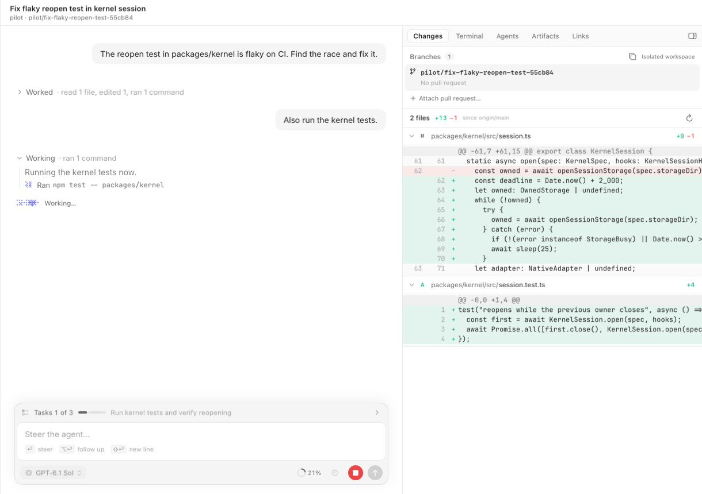
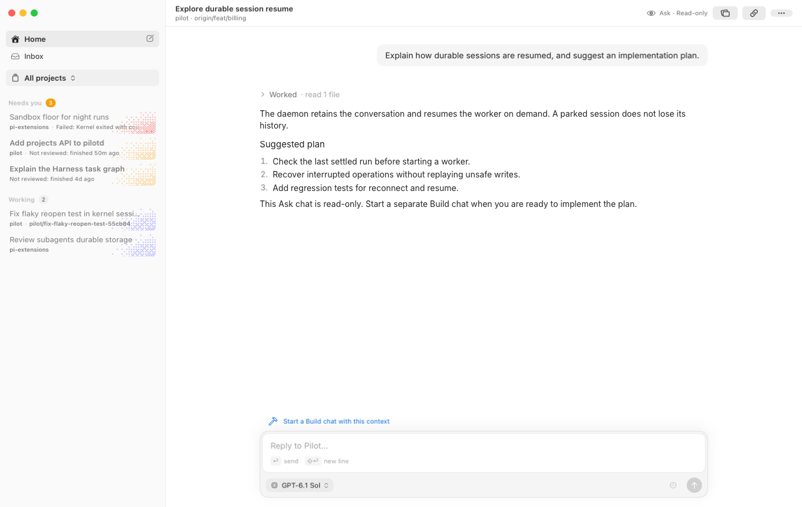
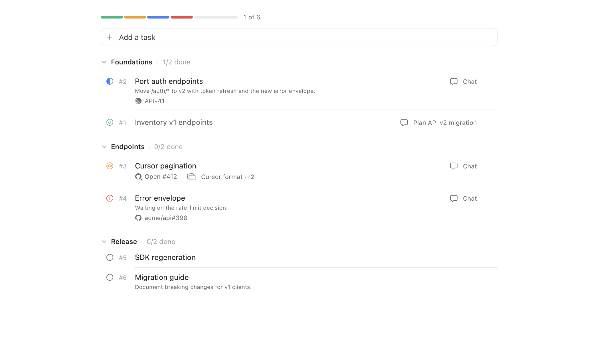

# Pilot

**Background coding agents. A native macOS app. You stay in control.**

Pilot runs [pi](https://github.com/earendil-works/pi) agents in the background, with durable chats and
isolated Build workspaces. Start a task, steer it when needed, and review the result as a
code diff, pull request or artifact. Agents keep working when you close the app.

Pilot is local-first. It uses your existing pi models, authentication and configuration, with a local
daemon managing sessions independently of the SwiftUI app.

[Get started](#get-started) · [Working with Pilot](#working-with-pilot) · [Development](#development)



*Screenshots are rendered from native views with demo data, not live conversations. Chat captures use a
stand-in window header; Build and mission captures are cropped to their working areas.
See [screenshot notes](docs/screenshots/README.md) to regenerate them.*

## What you can do

- **Run several agents at once.** Follow progress across projects, send follow-ups, queue messages or stop
  a run. Every session has its own worker process.
- **See what needs you first.** Home shows how every project is doing. The Inbox is the one place to act: chats
  that need you (each with a short reason), pull requests ready to merge, and Linear and Slack items, across
  projects or filtered to one. Each project has an Overview that starts with what is next for it.
  Right-click a chat and choose **Go to project** to open its project's Overview.
- **Jump anywhere from the keyboard.** ⌘K opens a command palette over chats, archived ones included (by title,
  branch, project or pull request number), pages, missions and tasks (`#25`), project scopes, Linear Inbox items,
  Slack reports in triage (by summary, channel or message text, newest first, resolved ones included), and actions
  such as new chat, pin, archive, stop, retry, opening the pull request on GitHub or **Merge PR…** for the open chat
  (also available after searching a PR number). Merging asks you to confirm the fresh PR head, target branch and a
  merge method allowed by the repository. GitHub enforces permissions and branch protection; Pilot never enables
  auto-merge or deletes the branch. Agents remain unable to merge. ⌘⇧M opens the merge confirmation for the open
  chat's latest open PR. ⌘⇧P opens the open chat's latest pull request (the newest open one, else the newest). Paste
  a Slack message link to find its report, or to add it to a project's Slack triage: Pilot reads and sorts the
  message, then opens triage on it. ⌘? (Command-Shift-/ on a US keyboard) opens the keyboard-shortcuts reference,
  also available from **Help → Keyboard Shortcuts** or by searching for shortcuts in ⌘K.
- **Let the display rest while agents work.** Keep the Mac awake without keeping the display on.
  Optional closed-lid work requires power and Wi-Fi; without both, agents pause and resume on the next
  full wake with connectivity. Screen locking is left to macOS. See [agent-aware sleep](docs/agent-sleep.md) for
  authorization and interruption limits.
- **Answer questions quickly.** When an agent needs a decision, its question replaces the message box with
  suggested answers. Pick one with the number keys and Return, or reply in your own words. The chat shows as
  needing you until you answer.
- **Explore before implementing.** Ask chats can read code and produce artifacts without repository write
  access. Move the discussion into a separate Build chat when you're ready to make changes.
- **Review work in context.** Build chats include a diff inspector, a [libghostty](https://github.com/Lakr233/libghostty-spm)
  terminal in the session workspace, task progress and pull request status. Attach a pull request in Changes
  using its GitHub link or just its number (`123` or `#123`) in the project's GitHub repository.
- **Coordinate bigger goals.** Missions group chats around a shared brief, decisions, tasks, dependencies,
  artifacts and activity, with an optional coordinator agent.
- **Keep useful context.** Build agents can save lasting decisions, preferences and lessons in project
  memory for later chats, rather than task status or secrets. A note can replace an outdated one, and
  duplicates are refused. Background summaries use byte-validated submissions, never hard truncation;
  unsuccessful compaction retries without discarding source notes. Each project's Memory page shows the
  notes and their summaries as a searchable tree. Pi skills, prompt templates, packages and compatible
  extensions are available in Build sessions.
- **Get more than text back.** Agents can publish images, interactive HTML and React previews, diagrams and
  static SwiftUI renders. Artifacts stay attached to their chat and can be linked to missions and tasks.
- **Query your databases.** Give a project's chats read-only or read-write Postgres access per environment,
  granted up front or when you answer the agent's request. See [Databases](#databases).
- **Bring work into Pilot.** Track Linear issues and Slack messages from configured sources, triage Slack
  messages by type, label and severity, see what waits on you across projects in one Inbox, then start a chat or
  mission from an item. Schedule work for later or for wake, online and time triggers.
- **Light or dark.** Pilot follows the macOS appearance; **Settings → Appearance** can pin light or dark.
  Home pairs dithered daytime clouds with a separate evening seascape in dark mode. Artifacts stay light documents
  in both.

## Get started

### Install a release

Download `Pilot-arm64.zip` from the [latest release](https://github.com/babariviere/pilot/releases/latest),
unzip it and move `Pilot.app` to Applications.

- Released builds target **Apple Silicon Macs running macOS 14 or later**.
- Releases bundle Node and the daemon, so you don't need a source checkout or a separate Node installation.
- Set up a model provider in [pi](https://github.com/earendil-works/pi) first. Pilot uses your pi agent directory
  (normally `~/.pi/agent`), including provider authentication.
- Install and authenticate [GitHub CLI](https://cli.github.com) (`gh auth login`) if you want agents to create
  pull requests or Pilot to monitor them.
- Install [Jujutsu](https://jj-vcs.github.io/jj/) **0.46+** and **Git 2.42+** for shared, isolated jj workspaces.
  Git-only projects use private clones instead.

These personal builds are ad-hoc signed, not notarized. If macOS blocks the first launch, verify the
release source before using **System Settings → Privacy & Security → Open Anyway**.
[Release and update setup](apps/macos/UPDATES.md) explains signing, packaging and automatic updates.
Updates pause agents after active tool calls finish, update the app and daemon, then resume unfinished
chats and subagents automatically. They do not wait for entire conversations to finish.
Chats with working subagents stay Working, even when the parent has finished its current reply.
Pending child work also reopens automatically after a daemon restart or a sleep pause.

### Headless Linux runtime (development)

The daemon and session workers can also run without a Mac app on **Linux x86-64**, using Node 24+
and a native dependency install on that host (`pnpm install --frozen-lockfile`, then `pnpm start`).
Compatibility depends on the available runtime, shell and native module ABIs, not a distribution name
or OS release. Linux CI executes the selected PTY, SQLite and artifact compiler dependencies and a real
headless daemon/kernel smoke test. [Production Linux packaging](scripts/linux/README.md) provides a
signed manifest, private Node/jj runtime and an explicitly provisioned persistent systemd user service.
CI verifies extracted production assets and real SSH logout survival. `PilotCore.LinuxSSHBootstrap`
provides repeatable initial SSH setup without a model chat, with signed-asset, prerequisite, persistent
service, identity and separate coordinator-isolation gates. App onboarding is separate work. Setup
requires a configured signing key and published trusted assets; it never installs packages, grants
linger, weakens security policy or copies credentials automatically. See [SSH setup](docs/ssh-bootstrap.md).

`GET /api/hello` returns a stable data-home `daemonId`, application `daemonVersion`, an independently
versioned protocol range (`minimumClientProtocolVersion` through `protocolVersion`, currently 1),
platform/architecture and explicit capabilities. Clients must pin the identity when pairing and verify
it, protocol compatibility and required capabilities before opening streams or sending mutations.
Changing the data home creates another identity; damaged identity files fail startup rather than silently
re-pairing. The unauthenticated API remains bound to `127.0.0.1` only.

Linux omits Mac energy/system-events helpers. Its agents and daemon-owned processes do not depend on a
client connection, and disconnecting a client does not stop them.
[Host-qualified workspace terminals](docs/workspace-terminals.md) use the same SSH
forward, retain remote shells through disconnect and expose terminal/job/transfer admission blockers
for safe maintenance. A lost terminal-open reply reattaches by instance instead of restarting a shell.
`LinuxSSHUpdate` provides [safe remote updates](docs/safe-remote-updates.md): a verified package and
independent remote journal wait for live jobs, shells and transfers before restarting. App connection
loss does not cancel an accepted update. Older runtimes without the maintenance capability are blocked.
HTML, React and image artifact authoring remain available; SwiftUI rendering requires macOS.
Linux coordinators require a root-owned, non-setuid
`bubblewrap` installation (`dnf install bubblewrap`, or the equivalent package-manager command) and working
unprivileged user, mount, PID and IPC namespaces, including nested-user-namespace disabling. The daemon
executes real write/chmod and descendant checks before advertising `coordinatorIsolation`; each fresh
coordinator repeats its boundary checks before loading worker code. Tool presence alone is not support.
Run `node packages/daemon/src/linux-coordinator-probe.ts` under the actual service user's security policy
for actionable diagnostics. AppArmor, SELinux, seccomp or service restrictions can prohibit namespaces;
correct the narrowly scoped policy, not global host security. There is no unrestricted or chmod fallback.

The coordinator sees a read-only host filesystem, including repository aliases and symlink targets, with
only private session scratch, durable storage and artifacts writable. It cannot create
nested user namespaces, acquire capabilities or see host processes through `/proc`. Pre-existing hardlinks
or shared writable private-state roots, including pre-existing nested bind mounts, are rejected. Normal network access remains available for model
providers and integrations; this is process/filesystem isolation, not a network or credential trust boundary.
Authentication uses a same-host canonical credential broker, not per-session copies. Each live worker and
its descendants receive a revocable capability for a private Unix socket. Operations are bounded, fixed
Pi/MCP auth reads and serialized transactions, never arbitrary paths, executable configuration writes or
an HTTP proxy. SDK OAuth exchanges remain in the caller process and sandbox; current canonical credentials
are read under the shared auth lock and updates are atomically persisted. Login/logout generations fence
stale results. A durable uncertainty marker blocks replay after a failed exchange, lost worker or broker
restart until an explicit new sign-in or changed canonical credential resolves it. Unavailable brokerage
fails closed. Native parents, subagents, Ask, model catalogs, MCP status/tracking and connection sign-in
helpers use the same authority. Existing Pi file/refresh locks are honored; unrelated external programs
are not retrofitted with the broker's crash journal. Nothing copies credentials between hosts.

The [pre-chat setup API and host-qualified client helpers](docs/credential-setup.md) report independent
host readiness and run a trusted, bounded setup PTY without an existing chat or working model. Audited
Codex device and Anthropic manual-code login use that host's canonical broker. Other provider flows and
cross-host MCP browser callbacks are explicitly unsupported, not silently relayed or copied. These are
onboarding integration APIs, not a complete devbox setup screen.

Read-only workers use the SDK settings-storage seam to read existing canonical configuration without
creating adjacent lock directories. Live writer locks, malformed, oversized or changing files fail closed;
configuration writes remain denied. Fixed trusted preloads install the same adapters before immutable
child SDK runtimes are constructed, after the Linux boundary has been validated.

The source includes [host-qualified client routing](docs/host-routing.md),
[durable operation receipts](docs/durable-operations.md), [server-side repository/file reads](docs/host-repositories.md)
and [staged image/artifact transfers](docs/host-transfers.md). These are integration adapters, not a complete
remote setup or chat-selection workflow in the app. They do not copy credentials.
[Shared context and delegation](docs/shared-context.md) adds explicitly enrolled canonical homes,
durable replicas/provisional proposals and receipt-backed sole execution grants. Accepted bounded work
can continue without the Mac; cancellation/reassignment requires target acknowledgment, not a timeout.
Enrollment/delegation/conflict presentation remains part of the pending devbox UI, not an enabled
end-to-end setup experience. The [remote lifecycle layer](docs/remote-lifecycle.md) preserves private
offline chat summaries and pinned identities across relaunch, reconciles ambiguous delivery receipts
without replaying mutations, and awaits local forward cleanup on normal quit without stopping remote
work. Devbox setup/selection and disconnected-state presentation remain separate UI work.

### Start your first chat

Chat messages render Linear, Slack and GitHub URLs as compact links with the service mark and a short name.
Names come from Markdown labels or the URL, without fetching private pages. Bare `#123` references stay literal
so mission task numbers are never mistaken for GitHub issues. Copying preserves the original text and URLs.

1. Open Pilot and **Add Project** to select a local repository.
2. Create a chat, choose **Build** or **Ask**, select a model and describe the task.
3. Let the agent work. Send a follow-up to steer it, or stop it if the direction is wrong.
4. Review its response, artifacts and, for Build chats, the changes and pull request. You decide what to merge.

Chats keep a readable placeholder title until the first agent turn finishes, then generate a title from
bounded conversation excerpts. Manual renames always win, and later turns do not automatically retitle the chat.

The app installs `pilotd` as a per-user launchd agent. Closing or quitting Pilot does not stop running
agents. Chat history is stored locally using [pi-durable](https://www.npmjs.com/package/@earendil-works/pi-durable).

If a chat's worker fails to start, fix the reported configuration or extension dependency problem and
choose **Retry Startup** below the error. Pilot reloads the worker with the original queued messages,
keeping its history and workspace. Saved messages remain readable even while startup is failing.
Workspace preparation failures cannot use this action.
You can also archive a failed startup without discarding its queued messages. Restore it before retrying.

## Working with Pilot

### Home, Inbox and Overview

The sidebar starts with **Home**, the **Inbox** and the project selector. Home covers every project: a short
summary, subscription usage (with extra-usage spend when the provider reports it), projects (under their folders),
work in progress, missions and recent activity.
The new-chat project picker also offers **Home (~)** for chats in your home folder without a project.
Pilot remembers this choice for later chats, including after restarting. You can still choose a project or **Other Folder…**.
The Inbox carries the badge and lists, most urgent first, what **Needs you**, what is **Ready to merge**, and your
Linear and Slack items. Its toolbar filters it to one project. Use **Open on GitHub** in a project's Overview
actions menu or the ⌘K command palette to open its repository in your browser. Pilot resolves the repository
on demand using GitHub CLI on the project's host, so its remotes and GitHub CLI sign-in must be configured.
Focusing a project adds its **Overview**, which
leads with Up next, then work in progress, pull requests, missions, schedules, the current Linear cycle, Slack,
memory and recent chats. Project folders are managed from the project selector's menu.

Below, chats are grouped by urgency in every scope: Missions first, then **Pinned**, **Needs you**, **Ready to
merge**, **Working** and **Recent**. Every Needs you row says why ("Failed: …", "Asks: …", "Long job: …",
"Limit reached · resumes 18:00"). It clears itself: a read result leaves once you leave its chat, failures stay
until retried and questions until answered. Lists show the PR, branch and reason, not diff counts.

A chat whose agent is idle while its background jobs run stays **Working**, with a quieter animation. Its working
line ("Waiting on 2 jobs…") opens a panel of running jobs with Stop on each. A job still running after an hour
moves the chat to Needs you.

In a chat, each turn's thinking and tool calls fold into one line ("Worked for 3 min · read 3 files, ran 2
commands"). Automatic items (pushes and pull requests, job results, subagent answers, mission updates, compaction
and stops) appear as one-line events where they happened, expanding on **Show**.

The **Agents** tab opens each subagent's live transcript, with its model and thinking level visible beneath
the header. Unreported thinking levels are labelled as such rather than inferred from the parent chat.

### Stopping and system messages

Stop ends the current run and returns your undelivered queued messages to the composer. System messages
from background jobs, PR follow-ups and other chats stay held, without restarting the chat. Use **Send now**
to start one run with them, **Discard** to remove all or an individual held message, or send your next
message to carry them along. Waiting system messages are read-only.
Stop also works during a sleep pause. Cancellation is saved without waking other chats and drains
before the paused run can recover at the next eligible wake.

Paused chats show a quiet line inside the conversation explaining the hold: sleep, lost connectivity
or a usage limit. The line replaces the working indicator and clears when work resumes.

If internet connectivity is lost, chats show **Paused offline** rather than exhausting model retries
into a failure. The daemon checks independent reachability hosts, so one blocked check host does not
pause chats, and resumes automatically when connectivity returns, even with the app closed.
Queued messages and unfinished requests survive restarts. Running native tools finish their current
round; they are never killed or replayed for an outage. Sleep, update, subscription and manual Stop
holds remain independent. Authentication, quota and provider errors are not treated as offline.

### Subscription limits

Chats pause new model requests and tool calls at **95%** of any subscription window. Active tools finish
safely, and subagents respect their own provider's limits, even when it differs from the parent chat.
Work resumes automatically when the blocked windows reset or a fresh usage reading drops below 95%.
Known pauses survive restarts and unavailable readings. Usage comes from pi's shared cache, without
additional provider polling; unknown usage cannot predict a limit, and in-flight requests may still use tokens.

If the provider reports a subscription usage limit before the cache catches up, the pending model request
pauses instead of failing the chat. Completed tool results stay saved and are never replayed. The pause
uses a known reset time when available; otherwise it waits for a fresh lower reading or **Force work**.
Transient rate limits, authentication and billing errors retain their normal error/retry behavior.

Beside the usage warning, **Force work** lets that chat and its subagents continue past the current
windows. The override ends when those windows reset or clear. **Pause at limit** restores the guard early.

When you message a long chat (context at 40% of the window or 100k tokens, whichever is lower) after
the provider's prompt cache has expired (5 minutes for Anthropic, 10 for OpenAI, longer with
`PI_CACHE_RETENTION=long`), Pilot compacts it first and your message waits behind the summary. Every model
request in the turn then reads the short summary instead of rereading the whole history at full price.
A warm cache is never discarded, and automatic messages don't trigger it.

**Continue with another model…** explains the change before confirming. A model from the same provider
keeps this chat and compatible context, but does not bypass its subscription limit. A different provider
starts a linked chat with a bounded plain-text handoff, not provider-specific history or compaction. It
takes over the existing workspace, branch, PR ownership and mission task claims. The original remains
readable and never resumes automatically. Previous subagent tasks are handed off as text, not recovered
with their old provider context. New-model usage limits still apply.
Finish or stop background jobs and close live terminals before changing the model for paused work.

### Ask and Build

| | Ask | Build |
| --- | --- | --- |
| Purpose | Understand code, discuss options, plan | Implement, test and deliver changes |
| Code source | Current checkout or a pinned origin-branch snapshot | Project workspace setting, with a per-chat override |
| Tools | Pilot's read/search tools, bundled web and session-local artifacts | Pi tools, bundled capabilities, compatible extensions, MCP and shell tools |
| Repository writes | No | Yes |
| Diff inspector and terminal | No | Yes |

Ask can inspect the current checkout, including local changes, without switching branches. An
origin-branch snapshot stays pinned for that chat. **Start a Build chat** carries the discussion into a
new implementation chat; it does not give the existing Ask chat write access.



### Workspaces and pull requests

Isolated Build workspaces keep file edits out of your own checkout. For jj projects, sessions use
separate working copies of a shared repository. **History and bookmarks are shared**, so agents must keep
rewrites and pushes scoped to their own task. Git-only projects use private clones. Direct-checkout mode
is also available, but edits there affect your checkout.

Project policy controls delivery. With **Require PR** enabled, agents deliver on a task branch for review.
Disabling it permits direct default-branch delivery. Pilot never auto-merges pull requests.

A chat with a ready-to-merge PR goes straight to **Ready to merge**, even if its result is not reviewed
or its chat is still open. Failures, unanswered questions and other actionable problems stay in **Needs you**.

Pilot monitors agent-owned PRs from isolated Build sessions for failed CI, unresolved review threads and
merge conflicts, including earlier PRs in a stack. It sends follow-up work only when the agent is idle
and no user messages are queued. Before a failed-CI follow-up, eligible jj workspaces try a safe,
conflict-free rebase onto the PR's current base, once per PR/base commit. A successful rebase waits for
fresh CI without spending a follow-up attempt; new review feedback still goes to the agent.
Follow-ups also ask the agent to check the PR's actual target branch and consider rebasing if behind,
preserving stack boundaries and other sessions' work, then waiting for fresh CI.
An unresolved thread is reported only once per latest-comment version, even across restarts and user
messages. Declined or already-addressed feedback need not be resolved on GitHub to stop repeat prompts.
New threads, replies or edits to the latest comment can trigger another follow-up; CI and conflict
retries remain independent. Pilot does not resolve review threads automatically.
Unsafe or conflicting rebases go to the agent instead. Automatic follow-ups are limited to three per
session, with a five-minute cooldown; sending a user message resets the limit. Results and blockers come back to Pilot,
not GitHub comments or reviews. Ask and direct-checkout sessions do not receive automatic PR follow-ups.
Owned PRs still blocked by conflicts, failing checks, unresolved review threads or a diverged stack after
three attempts (or without an automatic follow-up route) appear in Needs you once the chat is idle and
the cooldown has ended. Fixing the problem clears the reason; sending a message resets the follow-up budget.

GitHub writes are attributed to the chat in its activity and, for mission members, in mission activity.
The audit records a sanitized operation, PR or branch target when available, time and exit status, not
tokens, request bodies or command output. It retains the latest 200 actions per chat and 1,000 GitHub
events per mission. Compound commands and background starts show an unknown per-command exit status
rather than an inferred success.

Archiving keeps the conversation, but not necessarily its working directory. After the retention period,
Pilot can reclaim safe archived jj workspaces and restore them from a saved snapshot on resume. It can
also prune generated build and dependency output from legacy clones. Dependencies may need reinstalling
after recovery.
Ignored content does not block jj workspace reclamation and is discarded, except for bounded regular
mise local configs saved for recovery. Track any other files you need to retain.

### Missions

Use a mission when one goal needs several chats. Its shared brief and decisions give agents a common
starting point, while tasks record ownership, dependencies and progress. You can coordinate the work
yourself or use a coordinator chat, and review linked pull requests and artifacts in one place.
The mission's Overview shows a compact progress bar for each phase, or one overall bar for work without phases.
The mission icon in any mission chat's toolbar opens the mission's Overview.
Going the other way, the compass button beside a mission's title opens its coordinator chat.
Coordinators can link to member chats in their replies. Click a chat's name to open it inside Pilot,
including archived chats, without starting or restoring them.
Chat inspector panes open at a compact width, leaving the conversation most of the space. Drag the
divider to widen a terminal, diff or preview when needed.

The brief is the spec; tasks track progress and blockers; decisions record agreed choices.
Comments hold actionable discussion. Agents check existing discussions before posting and resolve
addressed comments after saving any lasting outcome. Unanswered questions stay open.

Task status icons fill clockwise from the top: empty for To do, one third for In progress and two thirds
for In review. Both task status menus show the same icons as the rows.

Tasks can belong to ordered phases, each with a name and optional goal. The Tasks tab groups tasks by
phase, folds finished phases, and lets you add, edit, reorder and delete phases. Drag tasks to reorder them
or move them between phases, and edit a task's dependencies from its menu.
The Overview shows one progress bar per phase with the current phase highlighted, and the sidebar names
the current phase and its progress. The coordinator tool manages phases too. Existing milestone names
migrate automatically. Phases complete when every task is done or dropped, reopen with unfinished work,
and record those transitions in activity. Empty phases are complete. Optional phase gating (Edit Mission)
is off by default; enabling it holds claims and starts in later phases until earlier phases finish, and
those tasks say which phase they wait for. You can still assign or start them yourself, which overrides
the gate; chats cannot.

Linear links default to read-only references, including existing links. The resources API can explicitly
manage a mission-level ticket and associate task contributions (`linearRole`: `managed` or `contribution`).
Only one mission can manage a ticket. Existing references require an explicit role upgrade using PATCH;
detach contributions before removing their manager. References never change task or Linear status, and
migration preserves tasks already marked Delegated. This is the storage/API foundation, not automatic
ticket completion or cancellation synchronization.

Open tasks contributing to a managed Linear issue become **Delegated** when someone else
is assigned in Linear. Returning the issue to you restores the previous status; unassignment changes
nothing. A manual status change wins until the assignment changes again. Delegated work is not done
and cannot start or satisfy dependencies. Existing chats keep running, and the coordinator is notified.
This uses read-only linked-issue checks on the Linear polling cadence, not writes to Linear.

The coordinator can start one chat on several tasks with `start` and `ids` (IDs, numbers or ranges).
Admission claims all tasks or none, ordering dependencies first and preserving the given order for ties.
Dependencies outside the selection must be done. Each task gets its own PR, based on the preceding PR's
head and linked as a stack. Supplied artifacts and links attach to every selected task. The whole opening
prompt, including all task bodies, instructions and references, must fit 4,000 characters; oversized
starts are rejected with the size, without truncation. The app's task Start chat action remains single-task.
It opens a small sheet with optional instructions, model and thinking (defaulting to the task's preferred
model), Build or Ask mode, base branch, and artifact or link references, validated like the coordinator's start.

A task can have a preferred model and thinking level, set from the task's menu in the Tasks tab or by the
coordinator. It uses the same scoped, price-capped model list as coordinator starts. New chats for the task
start on it unless a start picks another model; the coordinator cannot change or override a preference you set.

Decisions have an audience: **All chats**, **Coordinator only**, or **Reference** (the default).
Choose it when recording or editing a decision, or change it from the row's context menu.
Decisions have stable numbers (D1, D2, …). The coordinator can propose edits or removals for the user
to accept, edit and accept, or reject. Until accepted, the original decision stays binding.
Reference decisions are available on request; pinning a decision to a task includes it in that task's chat.

Only the coordinating chat sees subscription windows in its status and start tool results: percent
used and reset time per provider, with readings over two minutes old marked stale and missing data
marked unknown. Reads use the daemon's shared cache without waiting for providers. Worker tool results
contain no subscription usage, and no account, billing or cost details are exposed.

Coordinator updates wait while member chats are working or have running background jobs. An idle chat
with jobs counts as working: it is not reported as finished, and its jobs never create an update or wake
the coordinator. Updates settle for 30 seconds after activity stops, with a 30-minute safety cap measured
from the oldest pending event. The coordinator's own jobs do not hold updates back. Pending updates are durable;
running job processes belong to their live worker and do not survive orderly shutdown or replacement.
A job still running after one hour moves its chat to **Needs you**, with its name and elapsed time.
This fixed threshold is user-only attention, including inside missions: it never wakes a coordinator
and clears when the job ends or is stopped.
With the durable jobs extension, handles and logs remain available on resume. Unfinished records after
a crash are marked `interrupted`, never automatically rerun; subprocesses may remain alive.

Merges and unmerged closures of owned chat PRs also queue updates, even after the chat finishes.
Merge updates include completed tasks, newly unblocked dependents and known open stacked PRs.
Reference-only PR links do not trigger these updates, and refreshes or restarts do not repeat them.
Eligible member chats refresh to a fresh empty change on current main just before their next idle input,
not after every merge while idle. One project watcher reuses the existing PR-refresh scheduler (including
projects with only settled PRs), coalesces refresh bursts, and stops when no active chats remain. Base
consumers share the same main-moved event and fetch, rather than polling per chat.
Busy chats, dirty workspaces, open PRs, selected non-main bases and unpushed bookmarks stay in place.
Routine refreshes do not add timeline messages or wake idle chats. The coordinator is excluded.

Coordinating chats read one shared, read-only main checkout per project, updated by that same watcher.
They have no task bookmark, PR ownership or Changes pane, and delegate code changes and verification
to member chats. Their kernels and subprocesses cannot write to the source view. Tools start in a
per-chat scratch folder (also TMPDIR), retained across turns and removed on archive. Promoting a chat
unbinds its PRs and explains that they can be bound to a member chat. Demotion restores its isolated
workspace, but does not rebind those PRs automatically.



### Artifacts and integrations

Artifacts open in an isolated, offline WebKit viewer. HTML and React previews can use bundled libraries
such as Mermaid, ECharts and Motion, with D3 and Three.js available on request. Published revisions are
retained: a chat card opens the revision sent there, while the sidebar opens the latest version.
Inline `artifact://<id>` links open the latest revision directly in the artifact popup, with an artifact
icon beside the label. They work across chats, including archived artifact owners.
SwiftUI artifacts are static renders, not live app views.

Pilot bundles a pinned subset of [pi-extensions](https://github.com/babariviere/pi-extensions): sandbox,
patch editing, web, browser, subscription usage, background jobs and persistent subagents.
No separate extension installation is needed. Children inherit sandbox, patch, web and browser,
but cannot launch jobs or recursive subagents. Browser and web services still need their own prerequisites
and credentials. Secrets, router and Clef remain optional personal extensions; terminal-only UI,
workspace automation, PR automation and night mode are not bundled.

Pilot owns the `todo` tool. Each Build chat has one durable list in its Harness SQLite storage, shared
with its subagents even when they use another working directory. Todos survive restarts, workspace
reclamation and restore, and remain shared across chat attempts. Claim/release assigns work to the
parent or an individual child agent, not to a workspace. Closing (`done` or `closed`, case-insensitive)
clears the assignment; every other status counts as unclosed. Progress updates are committed events,
not filesystem polling. The daemon receives an unclosed count without reading todo bodies.
Child assignments identify an agent instance; after child-worker replacement, use `force` to reclaim
or release an old assignment. Assignments are advisory and never prevent updates or closing work.

Lists hold at most 256 items, each with up to 64 KiB of Markdown, and at most 1 MiB in total. Writes
over these limits fail without losing existing items; delete obsolete items to make room. Historical
todo document versions are not retained. Existing `.pi/todos` files and `PI_TODO_PATH` are ignored,
never imported or changed, and ignored legacy files are no longer specially saved during reclamation.

Build sessions also load personal pi configuration from `~/.pi/agent`. Bundled capabilities take
precedence over duplicate package entries before those copies execute; unrelated extensions remain
available. Ask loads only its restricted tools and bundled web, never personal/project extension
factories. [pi-anthropic-auth](https://github.com/gotgenes/pi-anthropic-auth) is required in Build, Ask,
child workers and daemon model calls, without modifying personal settings.

**Settings → Connections** lists the MCP servers in your global `~/.pi/agent/mcp.json` and whether each
is connected, needs sign-in or fails to start. pilotd checks them when it starts and whenever pi's MCP
files change (including `pi mcp login` in a terminal), never on a timer. Servers that use OAuth get a
**Sign in** button that runs pi's browser sign-in; chats pick up the new sign-in on their next turn. The
sidebar shows a quiet footer while a server waits for sign-in. Errors stay short; run `pi mcp list` for
the full message.
A chat whose tool call reached for a server that needs sign-in (or fails to connect) moves to **Needs
you** with that server named, and shows a one-line notice above its composer with the same action. It
clears once the server works again, you write in the chat, or you archive it.

Linear and Slack tracking use the configured
pi MCP servers named `linear` and `slack` and their existing OAuth sign-in, not separate Pilot API tokens.
Configure sources in project settings. Tracking is not a blanket promise of autonomous fixes or replies.

Linear sub-issues appear under their parent in the Inbox, the Overview's current cycle and the full list,
with a collapsible "N sub-issues" count on the parent, one level deep. When the parent is not one of your
tracked issues, its identifier, title and link (read with `get_issue`, cached and bounded) head the group
as a read-only row. Starting work on a sub-issue quotes its parent's identifier and title.

Each Slack channel can optionally track only new threads that mention you, directly or through one of
your groups. Add your own group handles in Tracking settings because the dedicated Slack MCP does not
expose memberships. A mention in any reply qualifies the parent thread, which is classified with its
usual bounded thread context and label effects. Existing items are unchanged. Mention discovery uses
channel-scoped Slack search, shares the daily Slack budget, and never searches other channels.
Public search is preferred; a private-capable search, still restricted to that configured channel,
also finds mentions in private-channel replies without re-reading unchanged threads.

Project settings provides per-team Linear state mappings for Todo, In progress, In review, Merged,
Deployed, Canceled and Duplicated, including separate choices for sub-teams. Only In progress is applied
when work starts; the other mappings are saved only and do not trigger automatic transitions.
In progress must map to a started-category state. Its Automatic option selects the state named
In progress, never the first state in workflow order. Other mappings may use any workflow state.
If a target is missing, ambiguous or no longer a started state, Pilot leaves the ticket unchanged and shows
a quiet error. Starting work still proceeds. Saved choices are rechecked against the issue's actual team.
Confirming Start chat or Start mission moves an eligible Linear ticket to that state, or adds an `eyes`
reaction to a Slack thread's parent message as you. The Slack reaction is attempted once per item,
counts an existing reaction as success, and can be removed on Done through the opt-in route below. Failures never
block the work and appear quietly on the item. These are the only tracking writes, never Slack messages or replies.
Linear size classification suggests Quick fix, Needs planning or Unknown from a bounded title and description.
It runs once per issue update, at most eight attempts per poll and 200 per UTC day across projects, with the
cheapest scoped model and no tools or thinking. Descriptions are transient; failed attempts remain Unknown
until the issue changes. User size corrections survive sync and feed the shared guide. This never auto-starts
work. Open Linear rows in the Inbox, the Overview's current cycle and the full list show Quick fix or Needs
planning as a chip, which also corrects the size (or use the row's Size menu). Needs planning rows make
Start mission the hover action, marked Suggested; others keep Start chat. Chats started from a sized ticket
are told its size and asked to suggest a mission, not start one, if the work needs planning.

Slack common cases group classifier summaries and corrections, never raw thread text. The shared grooming run
uses the newest 200 bugs within 30 days, preserves case IDs and memberships, and computes counts, severity mix,
majority label and trend locally. Trend compares the newest 15 days with the preceding 15 days. Empty cases
retire after 30 days without a report. Names, merge and split edits are local corrections, fenced against stale
model runs. The cases API exposes the window limit and truncation, and dashboard data includes the top three.
Up to 100 case identities are retained per project. The shared groomer admits at most one attempt per
source/project every five minutes, up to 48 per UTC day, folding at most 64 new corrections per run.
Slack triage's Common cases layout lists them by count, then recency. Selecting a case filters the table and
board to its messages; the inspector shows its severity mix and trend, starts a mission from the quoted case
summary (reviewed in the new-mission sheet, with its messages left unlinked), and renames, merges or splits it.
The project Overview shows the top three cases under Slack.

Triage keeps up to 500 corrections per project across sources. A debounced, tool-free worker folds three new
corrections (or a day with new corrections) into a short read-only guide. Classifiers use that guide and five
recent examples. Guides contain rules and summaries, not Slack excerpts. Tracking guide APIs support reading
and queuing a rebuild. Project settings show each source's guide read-only above its recent corrections (Slack under
Slack labels, Linear under Linear sizes once a team is attached), with when it was last updated and Rebuild, which
queues a run; the rules update in place once pilotd saves the new guide.

Pilot stores a classifier summary for each Slack message, and keeps up to 8,000 characters of its thread text in
the local tracking database for search only: the API never returns it. Messages stored before search existed
match by summary and channel. The triage inspector reads and quotes the message from Slack when you select it,
without saving it. Searching in Slack triage or ⌘K also matches thread text and pasted Slack links.
A message added from a link can come from any channel your Slack account can read. It is classified like a
polled one (a failed classification is retried; without one, it is added untyped, titled by its first line), and
stays listed, with its reactions, even when its channel is not tracked.
Project labels can do nothing, hide messages from the Inbox, or close them locally. Close labels never replace a
status you chose. Show hidden in Slack triage includes label-closed messages; reopening one teaches the classifier.
Slack items become Done locally when every PR of a linked chat has merged, or a linked mission completes.
The row explains why, for example “Done · PR #42 merged”. Closed unmerged PRs change nothing. Already Done or
Dismissed items stay untouched, startup PR baselines do not close old items, and reopening is never undone by
the same merge or completion.
During normal Slack refreshes, up to eight Open/In progress parents are checked for a ✅ reaction, sharing the
daily Slack budget. A ✅ from anyone marks the item Done with “Done · ✅ in Slack”. Reopening keeps it open while
that reaction remains present, even if its count changes. Removing it and adding it again is a new reaction.
When an item with a successful eyes reaction becomes Done (manually, from a merge, or from Slack), Pilot adds ✅
once. Already reacted counts as success; failures show a quiet row error without changing Done. Reopening never
writes reactions. Adding ✅ always uses the dedicated Slack server. That server has no remove-reaction tool.
To opt in to removing only the eyes reaction Pilot successfully added, create a local
`~/.pi/agent/pilot-tracking.json` (or under `PILOT_AGENT_DIR`) with an explicit MCP route:

```json
{
  "slackEyesRemoval": {
    "server": {
      "url": "https://mcp.example.com/mcp",
      "headers": { "Authorization": "Bearer ${SLACK_REACTION_API_KEY}" }
    },
    "tool": "remove_reaction",
    "dispatcher": { "tool": "dispatch", "nameKey": "name", "argumentsKey": "arguments" }
  }
}
```

Names and URL above are placeholders. Use the exact tool names from your server; omit `dispatcher` for a direct
tool. The daemon owns this MCP-over-HTTP connection entirely from `pilot-tracking.json`: it never reads or
registers a removal server in pi's `mcp.json`, and the tools do not appear in agent tool listings. Your existing
general-purpose MCP connections and their permissions are unchanged.
Use an API key scoped only to the removal tool. HTTPS is required, except for loopback development servers.
Supply the variable to the daemon process, or use a header beginning with `!command` to read the complete
`Bearer <key>` value from a local secret store (using pi's existing header expansion). Never put keys in project
settings, committed files or chat messages. Only an explicit Authorization header is accepted; no OAuth store
is used. A revoked or rejected key fails without opening a browser or falling back to OAuth or another server.
Tool-scoped keys enforce access on the server, rather than just hiding tools from a model.
Set `slackEyesRemoval.enabled` to `false` to leave a prepared route inactive until its key is available.
The inner tool must accept `{channel, ts, name}` (`name` is always `eyes`, without colons) and return JSON
`{ok: true}` on success, via MCP structured content or one JSON text block. The configured server must use the
same Slack user as the dedicated server: Slack only lets users remove their own reactions.
This local file is read afresh for each new Done attempt, never from a repository or replicated project settings.
Missing/invalid config, disabled routes, unreachable/missing tools, `no_reaction`, authorization failures and other
errors leave eyes in place, do not affect ✅ or local Done, and log one bounded line without retrying or falling
back to another server. Each item is attempted once, including across restarts; configuring a route does not
replay old Done items. No Slack messages or replies are sent.
Slack messages and Linear issue or project links open in their desktop apps when installed, with a
browser fallback when the app is unavailable. Copied links remain web URLs.
Slack links without a workspace ID use Slack's active workspace.

### Databases

Build chats of a project can query Postgres databases you configure for that project. Chats of other projects,
Ask chats and subagents do not get the tool. Create `~/.pi/agent/pilot-databases.json` (or under
`PILOT_AGENT_DIR`), readable only by you (`chmod 600`; Pilot refuses a file others can read):

```json
{
  "projects": {
    "~/src/github.com/acme/app": {
      "environments": {
        "local": {
          "read": { "url": "postgres://app_ro@localhost/app", "access": "allow" },
          "write": { "url": "postgres://app@localhost/app", "access": "allow" }
        },
        "staging": {
          "read": { "url": "postgres://app_ro:…@staging.example.com/app", "access": "allow" },
          "write": { "url": "postgres://app:…@staging.example.com/app", "access": "ask" }
        },
        "prod": {
          "read": { "url": "postgres://app_ro:…@prod.example.com/app", "access": "ask" }
        }
      }
    }
  }
}
```

Projects are keyed by the folder you added to Pilot. Each environment has a read connection, a write
connection, or both; leave one out to make that mode unavailable. `access` is `allow` (granted on first use)
or `ask` (the default): the agent asks with a question naming the environment and mode, and its turn ends. Picking
**Allow … access** in the app grants it; the app sends that decision to pilotd directly, and pilotd tells the agent.
Messages never grant access, even ones with the same words: typing a reply instead declines. Grants last for the rest
of the chat, and write access also covers reads. The file is read afresh for each call; new or removed projects apply
to the next chat start.

The agent calls `db({ action: "access" })` to list environments and request access, and
`db({ action: "query", env, sql, params })` to run one statement. Read mode runs inside `BEGIN READ ONLY` with the
extended protocol (one statement, no `COMMIT` escape) and is rolled back; in write mode, `statements` run in one
transaction. Every call opens its own connection with a 30 s statement timeout, a 5 s lock timeout,
`application_name=pilot-<chat id>`, and capped rows (100 by default, at most 1,000) and result size.
Results are sent to the model provider, so only configure data you are comfortable sharing with it.

Give read connections a role that can only read: `BEGIN READ ONLY` guards against mistakes, while the role is
what Postgres enforces. Only pilotd reads this file and the agent sees environment names, not URLs or request ids.
Agent shells still run as you and can reach pilotd's local API, so this is a guardrail for a cooperating agent, not
a secret store or a hard boundary. With the bundled sandbox in
`workspace-write` or `read-only` mode, add the file to `denyRead` in `~/.pi/agent/sandbox.json` to keep shells
from reading it; with the sandbox off (the default), they can.

## Development

### Build from source

Use **Node 24+**, the pnpm version pinned in `package.json`, and **Swift 6.2+** on macOS. Xcode Command Line
Tools are sufficient with a compatible SDK. On SDKs where SwiftUI's `@State` requires an Xcode-only macro
plugin, the build scripts select an older installed SDK; install full Xcode if none is available.

```sh
git clone https://github.com/babariviere/pilot.git
cd pilot
pnpm install
pnpm app:macos
open apps/macos/build/Pilot.app
```

The development app uses the checkout and local Node runtime. To run only the daemon in the foreground:

```sh
pnpm dev:daemon
```

Don't start a second daemon on the same port as the app-managed one. Use a separate `PILOT_HOME` and
`PILOT_PORT` for isolated development state.

### Debug project-memory compaction

Each project's memory directory under `$PILOT_HOME/memory/<project-id>/` retains
`compaction-latest.json` and, after a failure, `compaction-failure.json`. The default home is
`~/.local/share/pilot` (or `$XDG_DATA_HOME/pilot`). Inspect locally, for example:

```sh
python3 -m json.tool "$HOME/.local/share/pilot/memory/PROJECT_ID/compaction-failure.json"
```

These owner-only files contain **private memory text**: the source prompt, up to three model requests
and responses (text and tool submissions, not reasoning), validation errors and exact UTF-8 byte counts,
model, timing, and outcome. Do not share them unredacted. Each file is capped at 128 KiB; clipped
diagnostic fields explicitly report `truncated` and their original byte count. A subsequent success
does not overwrite the last failed run. General daemon logs do not contain these payloads.
Requests are recorded before contacting the model, so a failed or stalled call is inspectable even
without a response. Each attempt records its start and, when available, finish time.
An interrupted process may leave the latest record marked `running`; completed failures use the
existing automatic retry/backoff. Deleting these diagnostic files does not delete project memory.

### Checks

```sh
pnpm fmt:check
pnpm typecheck
pnpm test:fast                    # quick unit and offline feedback
pnpm test                         # full gate, including integration and stress tests
apps/macos/scripts/test.sh        # Swift tests
apps/macos/scripts/build.sh       # native app build
```

CI runs portable Node tests and typechecking on Linux, with a smaller macOS lane for native behavior
and packaging. Both lanes, Swift verification and production-package checks gate releases.
Publishing reuses the verified macOS ZIP and Linux runtime instead of building them again, except
when concurrent merges make Release Please select a different source commit.

See [testing](docs/testing.md) for suite selection and offline fixtures, and the
[CPU/memory](docs/performance-check.md) and [I/O](docs/io-performance-check.md) audits for measurement methods.
For agent-side artifact preview screenshots, install the optional renderer with `pnpm artifacts:browser`.
Publication still works without it.

### Dependency updates

[`renovate.json`](renovate.json) configures reviewed update PRs for pnpm dependencies, including required
Anthropic auth. Pi SDK packages and workspace overrides update together; `pi-extensions` tracks upstream
`main` while remaining pinned to a full commit SHA. Its updates are paused until upstream `main` includes
Pilot's embedding exports; the current pin stays on the compatible embedding commit. The native npm
manager refreshes `pnpm-lock.yaml` with dependency updates, and Renovate reports artifact generation
success or failure on every update PR.
Automerge is disabled. Renovate PRs also check an isolated production runtime before and after ZIP
relocation in the macOS Node CI job. Review those checks and the existing tests before merging.

Renovate runs through the [Renovate GitHub App](https://github.com/apps/renovate). Re-enable the
`pi-extensions` package rule only after upstream `main` includes Pilot's embedding exports and the
production runtime checks pass.

### Architecture

```text
Pilot.app (SwiftUI + libghostty)
    │ HTTP / WebSocket on loopback
    ▼
pilotd (per-user launchd agent)
    │ fork + IPC, one worker per session
    ▼
Kernel worker
    ├── pi-durable Harness: SQLite history, tasks and model loop
    └── native pi SDK: tools, prompts, extensions and provider authentication
```

| Path | Responsibility |
| --- | --- |
| [`apps/macos`](apps/macos) | Native app, terminal, artifact viewer and `PilotCore` protocol mirror |
| [`packages/daemon`](packages/daemon) | HTTP/WebSocket API, sessions, workspaces and worker supervision |
| [`packages/kernel`](packages/kernel) | Durable agent worker and native pi SDK integration |
| [`packages/protocol`](packages/protocol) | Shared client/daemon types |
| [`packages/artifacts`](packages/artifacts) | Artifact storage, preview rendering and bundled libraries |

The Harness owns history and the model loop. The native SDK supplies tools and extensions, not a second
model loop. Keep protocol changes in sync with `apps/macos/Sources/PilotCore`.

### Configuration and boundaries

| Variable | Default | Purpose |
| --- | --- | --- |
| `PILOT_HOME` | `~/.local/share/pilot` (or `$XDG_DATA_HOME/pilot`) | Local session data and managed repositories |
| `PILOT_PORT` | `4319` | Daemon port |
| `PILOT_AGENT_DIR` | pi's agent directory | Pi settings, packages and authentication |
| `PILOT_WORKSPACE_RETENTION_DAYS` | `1` | Archived workspace cleanup delay; `0` disables cleanup |
| `PILOT_PERF_TIMINGS` | enabled | Set to `0` to disable local, content-free request timing logs for new workers |

These are daemon environment variables. The app-managed daemon runs under launchd; exporting a variable
in your terminal does not change an already running daemon.

Heavy repository checks also use `PILOT_HOME`: Python 3 coordinates one Swift build/test and two Node
suite runs across checkouts. See [shared verification slots](docs/testing.md#shared-heavy-verification-slots)
for machine-wide limits and queue diagnostics.

[Local request timings](docs/request-timings.md) separate preparation, provider waiting and streaming.
They stay outside the transcript, have bounded private storage, and are never exported.

- **Keep the daemon local.** It binds to `127.0.0.1`, rejects requests with an `Origin` header and has no
  authentication. Do not expose it to a network.
- **Durability is not tool replay.** If a native tool is interrupted by a crash, it is reported as
  interrupted rather than automatically rerun. After an unexpected kernel exit, interrupted chats reopen
  automatically with crash backoff. A slow but connected kernel is not treated as dead.
- **Extensions must fit the host.** Extensions that replace the SDK session or start their own model loop
  are unsupported. Subagent controls require a pi-extensions version with the `subagents:*` host events.
- **Project trust still applies.** Project-local `.pi` resources load only for directories pi trusts
  (or when `defaultProjectTrust` is set to `always`).
