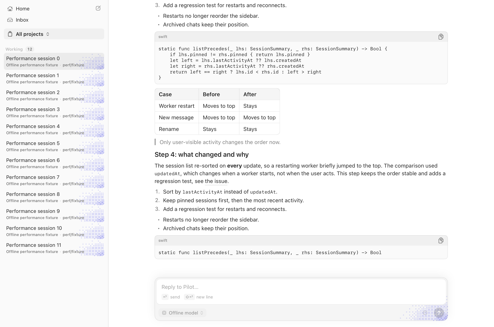
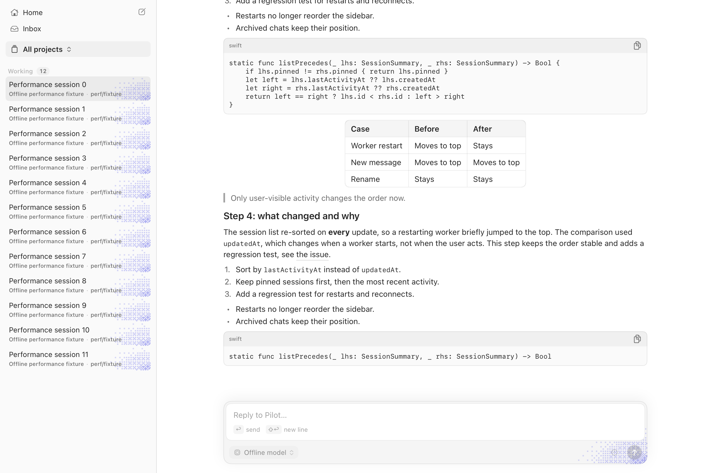
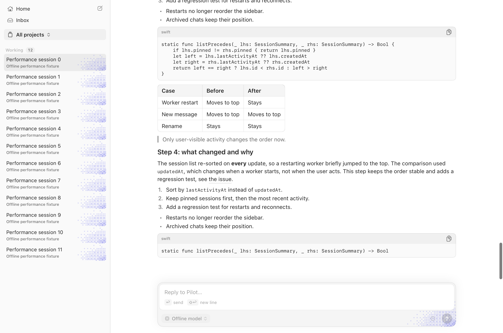

# Opt-in native transcript measurement

2026-10-20. **No-go for continuing the migration or changing the default:** streaming is cheaper, but rich
scrolling has a repeatable hitch/p95 regression. Keep the flag off. This is an experimental table/text path,
not a completed parity or rollout result. [Migration plan](reused-cell-transcript.md).

## Method

- Baseline: requested starting main `5852e8d8b793779b91cdbe15904d77eb15aefa1a`.
- Candidate: measured revision `ce0b43137ac9`, including the reviewed binding/height/selection fixes. Later
  leading-alignment/icon/lint corrections and the automatic PR rebase are not a fresh full-matrix comparison;
  the figures below remain historical evidence, not measurements of the latest head.
- Release builds through `apps/macos/scripts/build.sh -c release`; all comparisons held the same shared Swift
  verification slot. Frozen script copies were not edited during execution. `caffeinate -di` prevented idle
  sleep; lock checks ran before and after every sample. The final job completed with exit code 0.
- Apple M3 Pro, macOS 27.0.1 (26A434), Swift 6.4, built-in 120 Hz display, AC power, unlocked. The fixture window
  was 1280 × 820 points, using the unchanged reading-column rules. No thermal/performance warning was recorded
  by `pmset -g therm` after the run. Ordinary desktop activity was not instrumented.
- Same `bench-streaming.sh` workloads: 1,000 historical messages (latest 40 revealed) and 10 seconds of streamed
  Markdown, 4 updates/s × 100 characters or 10/50/100 updates/s × 12 characters. Rich scrolling uses the same
  750-row fixture, default history window, and 600 native scroll steps.
- Headline comparison: three alternating pairs for 4/s and rich scrolling, order main/native, native/main,
  main/native. Screenshot runs are excluded from these medians. A separate three-run candidate matrix followed.
- The fixture's existing absolute deadlines/coalescing remain unchanged. It does not print wall-clock elapsed
  time or delivery lateness; stress results do **not** establish delivered cadence. No 10,000-revealed-row,
  narrow-width, font/resize-storm, actual AX, focused-editor, or full interaction-parity claim is made.
- The original main matrix emitted all 15 valid on-screen reports, then its shell wrapper exited 127 because a
  comment edit shifted the running script's read offset. Only those emitted reports appear in the unpaired
  table. Earlier candidate samples affected by screen locking are excluded entirely.

Binary SHA-256 (documentation/screenshots do not alter the measured code):

| Build | SHA-256 |
| --- | --- |
| Main | `960fbfed46997e79a1615a6d361cb8ffb04bdc438a94c9cb6a3eaac770213093` |
| Candidate | `8cf758fb2d3ef47e507c0e0cc3d2e91fe706b00cad8f81caa0b591cc46a1402e` |

## Alternating paired results

Medians of three samples per variant. CPU is percent of one core. Footprint is the app process's physical
footprint, not app-plus-helper memory; this text/rich fixture does not measure interactive web/visual helpers.

| 4/s, 100-character chunks | Main | Native candidate |
| --- | ---: | ---: |
| Main-thread CPU | 33.8% | 16.8% |
| Process CPU | 34.8% | 18.0% |
| Hitch time ratio | 287.0 ms/s | 123.1 ms/s |
| Physical footprint peak | 245.0 MiB | 212.3 MiB |
| Peak RSS | 253.0 MiB | 221.5 MiB |
| TextKit size measurements | 525 | 226 |
| SwiftUI transcript-row evaluations | 80 | 0 |
| Five-second post-completion CPU | 0.0% | 0.0% |

This reduces main CPU by 50.3%, hitch time by 57.1%, and footprint by 13.3%, but is still far above the
under-10 ms/s final target. Native 4/s hitch samples: **103.8, 135.7, 123.1 ms/s**. Main samples:
**287.0, 273.9, 293.3 ms/s**. Native downward-row jumps and bottom-gap changes were zero in these pairs.

Native diagnostics in every paired 4/s run: 11 cells created, 2 mounted at measurement end, 54 bindings,
103 row measurements, 42 height transactions, 3 membership updates and 11 height-cache entries. TextKit size
measurements and whole-row measurements are different counters. This is not a large-history scaling proof.

| Rich scrolling | Main | Native candidate |
| --- | ---: | ---: |
| Main-thread CPU | 49.9% | 33.8% |
| Process CPU | 51.4% | 35.4% |
| Hitch time ratio | 70.7 ms/s | **169.2 ms/s** |
| Scroll-step p50 | 4.2 ms | 1.1 ms |
| Scroll-step p95 | 7.5 ms | **12.7 ms** |
| Peak RSS | 254.6 MiB | 196.1 MiB |

Every scrolling pair regressed in hitches and p95 despite lower CPU/p50. Hitch samples were main
**70.7, 117.0, 57.6** versus native **169.2, 175.2, 164.4 ms/s**; p95 was main **6.9, 8.4, 7.5** versus native
**12.7, 13.6, 12.4 ms**. Native steps over 16 ms were **20/600, 20/600, 11/600**, versus main
**4/600, 2/600, 1/600**. This is a blocker, not a scrolling improvement or paired-run noise.

## Separate full matrix

Three-run medians. The main batch preceded the candidate batch; these are **not alternating pairs**.

| Workload | Main CPU, main → native | Hitch ms/s, main → native | Footprint MiB, main → native |
| --- | --- | --- | --- |
| 4/s × 100 characters | 31.9% → 18.1% | 252.1 → 128.2 | 242.7 → 214.0 |
| 10/s × 12 characters | 46.6% → 25.2% | 324.7 → 149.0 | 245.7 → 215.0 |
| 50/s × 12 characters | 96.0% → 60.9% | 815.9 → 283.8 | 255.1 → 225.3 |
| 100/s × 12 characters | 96.7% → 83.4% | 843.0 → 585.0 | 275.7 → 247.3 |
| Rich scrolling | 43.8% → 29.5% | 104.1 → 146.4 | not sampled |

The final 100/s candidate sample reported **12 downward movements, 467 pt total, largest 186 pt**, and
23 bottom-gap changes. Two stress post-completion CPU samples exceeded the 1% idle budget (2.1%, 3.4%). These
are additional unresolved failures; the 4/s results must not hide them. Cause is not established by this run.

Sanitized per-run summaries, counters and idle samples are in
[`benchmarks/native-transcript-2026-10-20.json`](benchmarks/native-transcript-2026-10-20.json).

## Visual evidence and verification

These are actual release-app captures of the same offline synthetic fixture, not SwiftUI mockups and not
live user conversations. Code/table blocks still use compatibility hosts. The measured candidate screenshot
records the original centering regression. The follow-up corrects the compatibility host to explicitly use
leading alignment, without changing the table's natural size or column/selection rules.

| Main | Native candidate |
| --- | --- |
|  |  |

### Alignment follow-up

The compatibility host now uses `.frame(width: width, alignment: .leading)`, preserving a compact table's natural
width while aligning it with the surrounding text. A native regression fixture checks its left edge at
760 → 320 → 760 points. It is CI-only, like the other Swift tests. The release build passed after preserving
the PR's automatic rebase. This correction does not resolve or invalidate the historical no-go findings above.

This follow-up is an actual offscreen capture of the release app, not a mock. The screen was locked, so it
is visual evidence only: the table now shares the code/prose leading edge. No timings from that run are used.
Corrected executable SHA-256: `41e90c9b67d7684a293b140e6b5716c4f73ec017b0c314b80b061080b603cedb`.

The CI follow-up also fixes two attributable failures: the native reply copy button now resolves its image
through the shared icon vocabulary (instead of using the enum's raw case name as an SF Symbol), and explicit
observer detachment uses the same documented lifecycle-specific lint suppression as the existing scroll observer.

The local release build passed. Added native tests cover bounded height keys, stable streaming text views,
same-source selection-owner replacement/range clearing, cancellation, full host/session identity, membership
isolation, chrome changes alongside row revisions, vertical-only follow and explicit expansion anchor edges.
Swift tests run in CI, not locally, per the verification constraint. Full native interaction/AX, dark/Reduce
Motion, focused artifact recycling and offscreen selection parity remain unverified.

**Stop here:** keep the old renderer as default, retain this opt-in experiment for review, and do not begin
the remaining row migration or default switch on the strength of these measurements.
