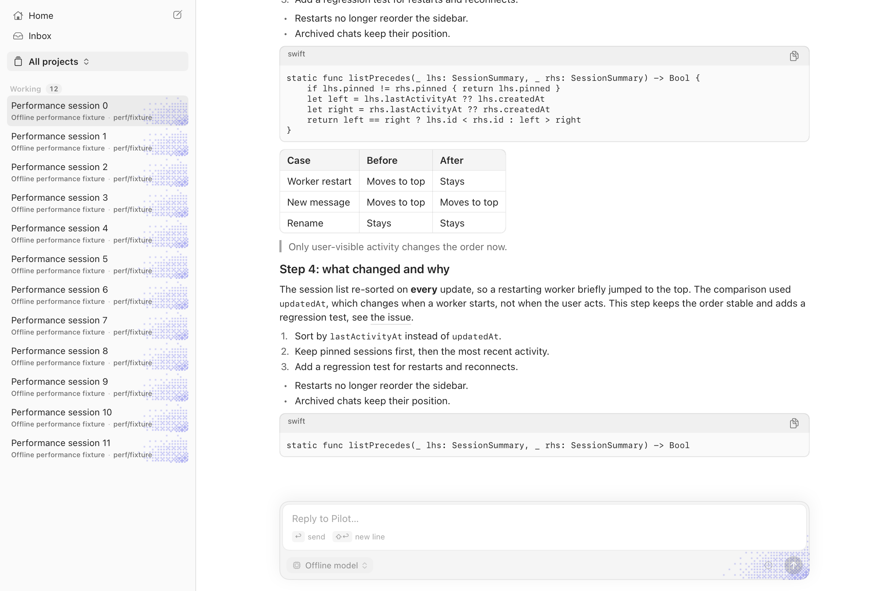

# Native transcript rows: implementation and release comparison

**Status: opt-in, not ready to become the default.** Conversation rows and Markdown blocks no longer use
generic SwiftUI hosts. Release measurements improve CPU and memory, and reduce the hybrid prototype's
scrolling cost, but still fail the shipping smoothness gates.

## Rendering boundary

The app shell and expanded-viewer sheets remain SwiftUI. The native transcript uses one `NSTableView`,
native AppKit row chrome, native buttons/menus/accessibility groups, and explicit measured heights:

| Content | Native path |
| --- | --- |
| Assistant prose, headings, lists, quotes | Reused `MessageSelectionTextView` regions |
| Code and tables | `NativeCodeBlock` and the existing native `MarkdownTableView`, with per-message selection |
| User messages | Native hugging bubbles, bounded raw-text folding, copy/edit actions and timestamps |
| Work, thinking, reads and tools | Native disclosures, existing Core Animation shimmer/dots/reveal, native code/diffs/output |
| Events, questions and errors | Native timeline/error chrome and expandable native Markdown |
| Mermaid | Existing off-main native bitmap engine; the same faithful sandboxed WebKit fallback |
| Image artifacts | Off-main ImageIO decoding and native image views; animated images retain native animation |
| Header, footer, earlier messages, schedules | Native controls and subscriptions, including retry/reconnect/edit/cancel actions |

There is no `TranscriptRowHost`, hosted `RowView`, or hosted `BlockView` in this path. Existing interactive
artifact engines are deliberately preserved: HTML/React/shader and SwiftUI-snapshot artifacts still use their
sandboxed preview engine. Native visuals keep their existing interactive visual component in a dedicated
adapter, including its SwiftUI chart/control internals. “Native rows” does not mean every artifact engine is
AppKit or that WebKit has been removed.

The image height cap remains 720 pt, native visuals remain uncapped, the column stays 760 pt, and selection
remains per Markdown message. Expanded viewers are owned outside reused cells. Lightweight row contexts
hold resource/environment/expansion/action references, not whole transcript presentation/history snapshots.
Asynchronous preparation, diagram drawing and artifact loading are cancelled/fenced across bindings.

## Reproducible comparison

- Production source: `62733d1635a4c7d9a02ff24b530423b33361b96a`.
- Frozen main baseline: `5852e8d8b793779b91cdbe15904d77eb15aefa1a`, not moving main.
- M3 Pro, macOS 27.0.1 (26A434), release build, AC, unlocked built-in 120 Hz display.
- One shared Swift verification slot across the matrix. No profiler attached.
- Same offline `--performance-check` fixture and cadence. One warmup per renderer, then three alternating
  pairs per workload: main/native, native/main, main/native. Warmups and final screenshot runs are excluded
  from headline medians.
- One separate nominal-rate stress pair each at 10/50/100 updates/s. These are diagnostics, not repeated
  acceptance samples or verified delivered-cadence measurements.
- Unlocked guards passed before/after runs. No thermal or performance warning was recorded.

The fixture has large canonical history but retains the normal initial history window. It does **not** prove
1,000/10,000 actually revealed rows or bounded internal rendering of one giant message/work row.

### Primary medians

| Metric | Frozen main | Native rows |
| --- | ---: | ---: |
| 4/s main-thread CPU, percent of one core | 33.5% | 13.9% |
| 4/s hitch time ratio | 261.7 ms/s | 73.5 ms/s |
| 4/s peak physical footprint | 243.1 MiB | 209.6 MiB |
| 4/s peak RSS | 263.6 MiB | 227.5 MiB |
| Rich-scroll main-thread CPU | 46.7% | 17.3% |
| Rich-scroll hitch time ratio | 14.0 ms/s | 33.0 ms/s |
| Rich-scroll step p50 | 4.3 ms | 0.2 ms |
| Rich-scroll step p95 | 5.7 ms | 5.9 ms |
| Rich-scroll peak RSS | 253.5 MiB | 201.9 MiB |

### Every primary pair

| Pair | 4/s hitches, main → native | Scroll hitches, main → native | Scroll p95, main → native | Scroll steps over 16 ms, main → native |
| --- | --- | --- | --- | --- |
| 1 | 254.1 → 73.5 ms/s | 29.7 → 56.6 ms/s | 5.7 → 8.8 ms | 0 → 3 / 600 |
| 2 | 261.7 → 81.0 ms/s | 12.2 → 33.0 ms/s | 5.5 → 5.3 ms | 1 → 3 / 600 |
| 3 | 262.9 → 62.8 ms/s | 14.0 → 32.2 ms/s | 6.6 → 5.9 ms | 1 → 0 / 600 |

All native rich-scroll runs ended within the document: viewport top 5,489, bottom/document 6,202; five
mounted cells, eleven created, 43 height-cache entries. This is a small-window reuse check, not a scaling
proof. Each native 4/s run reported one 6 pt newest-message reversal and zero bottom-gap changes. All three
reported 0.0% post-completion CPU over the existing five-second idle sample.

The earlier hybrid report's scroll hitches/p95 were 90.5 ms/s / 11.0 ms. The new port's 33.0 / 5.9 is useful
progress, but those are separate batches with different main control readings. The current paired main
comparison above, not a cross-batch improvement, decides the default-switch gate.

### Nominal-rate stress diagnostics

| Rate | Hitches, main → native | Main-thread CPU, main → native | Native reversals / bottom-gap changes |
| --- | --- | --- | --- |
| 10/s | 230.7 → 69.4 ms/s | 39.5% → 18.5% | 1 (6 pt) / 0 |
| 50/s | 762.1 → 115.4 ms/s | 99.0% → 42.8% | 7 (38 pt total) / 0 |
| 100/s | 810.7 → 281.1 ms/s | 98.5% → 74.7% | 3 (16 pt total) / 0 |

At 100/s the measured native apply/publish call counts were 942/840, versus main's 520/502; at 50/s they
were 500/499 versus 335/331. Scheduling/coalescing and elapsed-work differences prevent a simple throughput
claim. Do not describe the nominal stress rates as verified delivery or use these single samples as budgets
passing. Native idle CPU was reported as 0.0% after these runs.

## Visual and verification record

The following are saved **real release-fixture screenshots**, not the static mock or exact pixel-parity proof.
They show the same final streaming content at measured bottom-follow. Leading table/code alignment was
inspected. They do not cover user folding, tools, dark mode, artifacts or accessibility interactions.

| Frozen main | Native rows |
| --- | --- |
|  |  |

The separately attached SwiftUI layout artifact is a mock/reference, not a check of these real views.

- Release build passed, including the final measured production source.
- Swift syntax parse, font-role guard, SwiftLint correctness gate and whitespace checks passed.
- Regression fixtures were added/updated for native row/chrome kinds without conversation hosts,
  hugging/folding, active-work disclosure, observer fencing, surface-qualified link dispatch, code/table
  selection/reuse, leading sizing and native diagram presentation.
- Swift test compilation/execution remains CI-only. No local Swift suite was run; these new fixtures must not
  be described as runtime-passing before their exact-head CI results.
- Focused artifact/field-editor recycling, selection through full recycling, keyboard/VoiceOver journeys,
  dark/Reduce Motion, interactive artifact edges/late sizes, renderer teardown and large revealed histories
  remain default-switch gates, not accepted behavior based on a screenshot.

## Verdict and provenance

**Do not switch the default or delete the old transcript yet.** Every 4/s native sample is above the
under-10 ms/s target; rich-scroll hitches are worse than main in all three pairs. Median p95 is close but one
pair regresses. Lower CPU, footprint and median scroll-step cost do not override those blockers.

Raw summaries, counters, source hashes and sample categories are in
[`benchmarks/native-transcript-native-rows-2026-10-20.json`](benchmarks/native-transcript-native-rows-2026-10-20.json).
The immutable candidate SHA-256 is `37affd71bdf89bc1ef42be8595b07b6ca555cecd6364e9b9f5dc8686f057f43b`,
Mach-O UUID `75FB5683-9861-3222-8DBC-C986D89A6BCD`. Baseline SHA-256 is
`960fbfed46997e79a1615a6d361cb8ffb04bdc438a94c9cb6a3eaac770213093`.
The frozen comparison script and full local output hashes are recorded in the JSON.

Visible benchmarks must run deliberately. Hidden or inactive-Space runs are not substitutes for on-screen
smoothness evidence.

The [headless attribution follow-up](native-transcript-headless-attribution.md) identifies a small redundant
selection-reset operation. Its component-only raster results do not replace this full-app no-go verdict.
