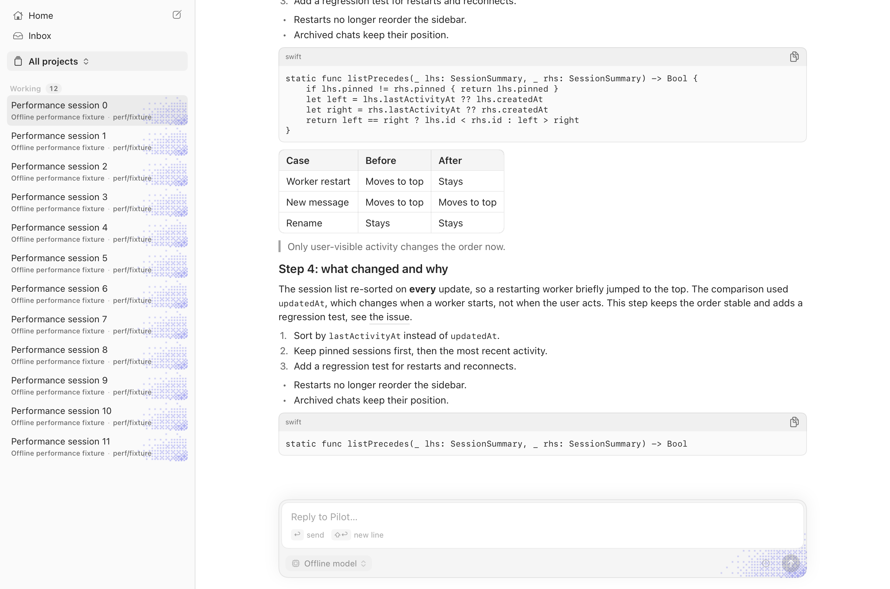

# Native transcript: rich-scroll follow-up

2026-10-20. Scope: the opt-in table/text path only. No migration of the remaining row types or default switch.
The original comparison is retained in [the initial report](native-transcript-measurement.md).

**Final result: NO-GO. The rich-scrolling regression is not fixed.** Scoped reuse/sizing fixes reduce CPU and
preserve streaming gains, but every final pair still has worse native scrolling hitches and p95. Keep the flag
off and this PR draft. No remaining-row migration was started.

## Profile before the fix

Instruments 27.1 Time Profiler, 1 ms sampling, release binaries, unlocked built-in 120 Hz display, AC power.
The native input is PR head `70637054770179eb404054c65ee761f951d157de`; the frozen main baseline is
`5852e8d8b793779b91cdbe15904d77eb15aefa1a`. The workload is the unchanged `--performance-check --scrolling --rich`.
The native trace's loaded Mach-O UUID was `2F01E557-5F67-37D1-BBB1-809BBE92FA43`, matching the frozen executable;
the baseline UUID was `3EE5D7B3-5D17-3C13-AA7A-EEE663808BD7`.

Launch the executable directly, then attach Instruments to its PID. An initial `xctrace --launch` attempt
resolved the installed application by bundle identity rather than using the requested frozen binary. Those
recordings are discarded, not mixed into either profiling evidence or acceptance measurements.

Native main-thread samples (whole attached trace):

| Inclusive stack | Sampled CPU time | Share of 3,265 ms |
| --- | ---: | ---: |
| `NSHostingView.layout` | 982 ms | 30.1% |
| Native Markdown block sizing | 242 ms | 7.4% |
| Height transaction | 204 ms | 6.2% |
| Native Markdown message apply | 101 ms | 3.1% |
| Cell binding | 70 ms | 2.1% |
| TextKit measurement | 40 ms | 1.2% |

These are statistical CPU samples, not per-step wall times. Groups overlap and must not be added. Native
profiling had 32/600 synchronous scroll steps over 16 ms, versus 9/600 in the profiled baseline; profiler overhead
means those runs are not the acceptance table. Native CPU was concentrated in bursts when rows were realized.
The baseline had 418 ms under hosting layout out of 5,198 ms sampled main CPU.

Two in-scope problems are visible in the source and stacks:

1. Recreated native Markdown messages bypassed the existing synchronous, bounded `PreparedMarkdownCache`.
   Even previously prepared history temporarily became a plain-text row and then a rich row, with additional
   preparation, sizing and height transactions. The native path now uses the same mirror as `MarkdownView`.
   Streamed prefixes replace the last *prepared* prefix, not an unrendered intermediate update, keeping retention
   bounded when updates coalesce.
2. Compatibility hosts requested the default min/ideal/max SwiftUI size probes despite the row owner already
   installing their width and measured height. They now request intrinsic sizing only. This does not convert
   code, tables or diagrams to a new renderer, nor remove their asynchronous size-change callbacks.

The table's accidental centering was already corrected at `70637054`: the compact compatibility block uses
leading alignment without stretching. Its width/selection rules remain unchanged.

The initial cache/sizing-only trial was insufficient: rich scrolling was 127.3 ms/s and p95 12.0 ms versus
27.1 ms/s and 6.8 ms for its paired baseline. The 4/s case still improved main CPU (34.4% to 17.5%) and hitches
(264.7 to 118.8 ms/s). These single exploratory pairs are not the final acceptance comparison.

The next scoped correction retains content objects inside the existing cell reuse pool instead of only reusing
empty cell shells. Native text and compatibility cells have separate identifiers. Rebinding clears work and
identity, preserves reusable TextKit/host objects, rebinds the message's selection owner, and fences old callbacks.
A changed message gets a new SwiftUI subtree identity, so interactive state is not transferred. Resource changes
still tear the cell down completely. No per-history-row view cache or native compatibility renderer was added.

The final candidate also reads an explicitly sized host's intrinsic height instead of forcing a nested AppKit
placement/render pass during measurement, retaining the old fitting path if intrinsic height is unavailable.
The diagnostics exposed another correctness issue: `NSClipView.scroll(to:)` permits programmatic requests outside
the document. One exploratory run ended with viewport bottom 10,393 and document height 6,154. A native clip-view
subclass now applies AppKit's `constrainBoundsRect` before programmatic scrolling. All final runs end within the
document with five mounted rich rows; blank viewports are not accepted as a speedup. The workload/cadence itself
is unchanged.

Final verified Time Profiler sample comparison (inclusive groups overlap):

| Native stack | Input | Final candidate |
| --- | ---: | ---: |
| Total sampled main CPU | 3,265 ms | 2,327 ms |
| Hosting layout | 982 ms | 728 ms |
| Native block sizing | 242 ms | 54 ms |
| Height transaction | 204 ms | 114 ms |
| Cell binding | 70 ms | 20 ms |
| TextKit measurement | 40 ms | 17 ms |

Hosting/layout remains substantial (31% of sampled main CPU) after binding and measurement costs shrink.
The remaining tail coincides with realizing/rebinding compatibility-host content. Native compatibility rows
are the next architectural route indicated by the profile, beyond this scoped wrapper work. This trace does
not prove that every remaining millisecond is code-block work or that native rows are the only conceivable
optimization. The rich fixture exercises code/user/work rows, not a table/diagram matrix. No renderer migration
is claimed or silently started.

## Final alternating release pairs

Three pairs per workload, main/native then native/main then main/native, on the same unlocked 120 Hz display and
AC power. Frozen scripts and binaries, one shared Swift slot, lock checks before/after every sample. Final command
exited 0; no thermal/performance warning recorded. Ordinary desktop load was not instrumented. Profiling and
screenshot runs are excluded. The main baseline remains the requested frozen `5852e8d8`, not today's moving main.

| Rich scrolling, median of 3 | Frozen main | Native |
| --- | ---: | ---: |
| Main-thread CPU, one core | 48.8% | 22.9% |
| Hitch time ratio | **15.7 ms/s** | **90.5 ms/s** |
| Scroll step p50 | 4.3 ms | 0.2 ms |
| Scroll step p95 | **6.8 ms** | **11.0 ms** |
| Peak RSS | 253.5 MiB | 205.9 MiB |

All three pairs fail both scrolling criteria:

| Pair | Hitch ms/s, main → native | p95 ms, main → native | Steps >16 ms, main → native |
| --- | --- | --- | --- |
| 1 | 23.6 → 104.5 | 6.8 → 11.2 | 1/600 → 13/600 |
| 2 | 7.9 → 89.0 | 6.9 → 11.0 | 0/600 → 13/600 |
| 3 | 15.7 → 90.5 | 6.7 → 11.0 | 0/600 → 10/600 |

| 4/s × 100 characters, median of 3 | Frozen main | Native |
| --- | ---: | ---: |
| Main-thread CPU | 31.5% | 17.3% |
| Hitch time ratio | 238.2 ms/s | 104.4 ms/s |
| Physical footprint peak | 243.2 MiB | 210.8 MiB |
| Peak RSS | 263.5 MiB | 231.9 MiB |
| Post-completion CPU, five seconds | 0.0% | 0.0% |

Streaming gains remain: main CPU −45.1%, hitches −56.2%, footprint −13.3%. Each native run has one 6-point
newest-message reversal in the corrected monitor and zero bottom-gap changes; do not describe this as zero jumps.
These results do not meet the under-10 ms/s default-switch target either.

Final native executable SHA-256: `ade37ab08d96e96b7ba8f7eacbd0b0d16c6440cc213c6c6da93c4f060cd68396`;
UUID `5962EBDB-F23B-307A-B0BF-A24D40A709AC`. Full source/binary hashes, per-run summaries and explicitly excluded
exploratory matrices: [paired evidence](benchmarks/native-transcript-d17-pairs-2026-10-20.json).

Actual unlocked release-fixture capture, not a mock or live conversation. The table remains leading-aligned:

## Cheap stress investigation

One 100/s sample each before/after the cache/sizing patch had zero reversals and zero bottom-gap changes; the
historical bad sample was not reproduced. That is not proof of repair. Code inspection also found that the native
jump monitor could include hidden header/footer anchors with an empty message ID. The follow-up excludes hidden
and empty-ID markers, with a dedicated native fixture. Bottom-gap changes are an independent document/viewport
measurement. The original reversal counts therefore remain historical but ambiguous, not an accepted regression
test. Stress delivery cadence is still not established by this harness.

The final viewport-constrained binary was also checked once at 100/s with the corrected monitor: 11 reversals,
57 points total, largest 6 points, **zero bottom-gap changes**, 0.4% post-completion CPU. The viewport stayed at the
document bottom. This sample shows small row-height movement while pinned, not the earlier large 186-point
movement/bottom-gap sample; it does not prove that every anchoring case is repaired or establish stress cadence.

## Verification and boundary

- Final release build, Time Profiler capture, all 12 unprofiled paired runs and actual screenshot captures exited 0.
- Frame/lock guards passed. Final native rich viewports end at 6,154 points, exactly the document bottom.
- Diff whitespace, shell syntax, font-role and source-equivalent SF Symbol vocabulary guards passed.
- Added native fixtures cover immediate prepared-cache restoration, coalesced-prefix replacement, bounded host
  sizing, intrinsic/fitting-height parity, content-object reuse, selection/resource identity fences, old callback
  rejection, hidden-marker filtering and constrained programmatic scrolling. Swift tests remain CI-only, not
  claimed as passed locally. The input CI did not reach the later UI partition.
- Image cap 720, uncapped native visuals, per-message selection scope and the default renderer are unchanged.

**Stop at the boundary:** the requested rich-scroll gate remains unmet. The profile directs the next material
work toward remaining compatibility-host rendering, but this is not an exclusive-cause proof. No native code,
table, diagram or remaining-row migration was implemented here. Keep the opt-in experiment draft/default-off.

Bounded sample summaries and binary hashes are in
[`benchmarks/native-transcript-rich-profile-2026-10-20.json`](benchmarks/native-transcript-rich-profile-2026-10-20.json).
Raw attached recordings remain local at `/tmp/c912-rich-{native,baseline}-attached-before.trace`.

## macOS CI at the input head

[PR job](https://github.com/babariviere/pilot/actions/runs/39411839323/job/118591259082) checks the merge of
`70637054` into `7004f365`. [Unmodified main's job](https://github.com/babariviere/pilot/actions/runs/39411315167/job/118589489777)
has the same two failures:

- The shell wrapper requires three diagnostic pointer tests that its Python mock fixture omits. The first error
  is `required native test did not start: diagnoseSetupSubmitsReasonOrBlankThroughMountedControls`.
- The broad Swift test step times out at 12 minutes. Later native UI partitions are never reached. The timeout's
  cause is not established; this is not classified as an infrastructure flake.

The previously failing SF Symbol vocabulary test passes at the input head. No new transcript-specific test failure
was identified in those logs. Shared CI repair is tracked separately; no unrelated test suppression or timeout
increase is included here. New native regression tests remain CI-only, as requested.
