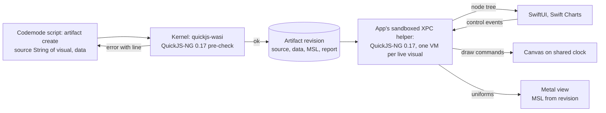

# Native agent visuals (design proposal)

Status: design decided. The kernel side of phase 1 is implemented: the `visual` kind, the pre-check and the node
tree API 1 (`packages/artifacts/src/visual`, fixtures in `packages/protocol/fixtures/visual`). The decisions are
listed at the end.

## Goal

Agents show interactive visuals inline in the chat: stats, tables, charts, controls, 2D drawings and
shaders. Pilot renders them with SwiftUI, Swift Charts and Metal, using Theme tokens. A
visual should feel like part of the reply: it follows light and dark mode, uses Pilot's fonts, scrolls
and selects like the transcript, and costs no WebKit process.

Inline visuals grow to their full content height without an overall cap or nested scroll area. Charts,
canvases and shaders retain their explicit heights. The expanded viewer still scrolls within its viewport.

HTML, React and shader artifacts stay as they are. Visuals are a new artifact kind for the common cases
where native rendering is smoother, lighter and better integrated:

| | Web artifacts today | Native visuals |
| --- | --- | --- |
| Process and memory | One WebKit content process per view (tens of MB) | A small script VM per live visual (a few MB) |
| Height | Measured after the page renders | Known from the node tree before drawing (D3, D8) |
| Theme | Light documents only | Theme tokens, light and dark |
| Motion | Page timers and `requestAnimationFrame` | The app's shared clock, paused when hidden (D2) |
| Accessibility | WebKit's tree inside a web view | Native Text, controls and Swift Charts |

The reference is Zeron's `show_visual`: a sandboxed Luau script returns a tree of `ui.*` nodes that the
client renders natively, with every draw and control exercised before the reader sees it.

## Agent-facing API (a function, written in codemode)

Pilot exposes tools only through codemode, so agents author visuals inside codemode scripts. A visual
is a plain JavaScript function. The agent defines it in its script and passes its text with
`String(visual)`, together with the data as a real object:

```js
const rows = await tools.db({ query: "select region, p95, p99 from latency" });

function visual({ ui, state, data }) {
  const s = state({ metric: "p95" });
  return () =>
    ui.column({ gap: 16 }, [
      ui.text("Latency by region", { size: "lg", weight: 600 }),
      ui.tabs({ options: ["p95", "p99"], value: s.metric, onChange: (v) => (s.metric = v) }),
      ui.chart({
        type: "bar", height: 220, unit: "ms",
        x: data.map((d) => d.region),
        series: [{ name: s.metric, values: data.map((d) => d[s.metric]) }],
      }),
    ]);
}

await tools.artifact({ action: "create", kind: "visual", title: "Latency", source: String(visual), data: rows });
```

- **No escaping, no files.** The visual is ordinary code in the script, so its backticks and `${...}`
  need no escaping, and codemode's own parser catches syntax errors before the call. `String(fn)`
  returns the function's exact source text in QuickJS (checked in codemode). Nothing is written to disk,
  so it also works in Ask.
- **Why `String(visual)` and not `visual`:** codemode passes tool arguments as JSON, which drops
  functions (checked: a function argument arrives as nothing). When `source` is missing for a visual,
  the tool error says to pass `String(visual)`. Decided: agents pass `String(visual)`.
- **Data is separate.** `data` is any JSON value up to a bound (for example 1 MiB), never spliced into
  code. The same function can be republished with new data.
- **The function runs once per VM**, building state and returning the view. The view is called again
  after every handler; handlers only assign to state.
- **Language:** codemode scripts are JavaScript, so visuals are JavaScript too. TypeScript remains the
  format of the reference: a `visual.d.ts` in the skill documents `ui`, node props, token names and
  limits. Unknown props and bad values are caught at runtime by the pre-check, with lines inside the
  function.
- Node set for v1: `column`, `row`, `grid`, `text`/`span`, `stat`, `table`, `chart`
  (bar, line, area, scatter), `rule`, `space`, `link`; controls `tabs`, `toggle`, `slider`, `button`;
  `canvas` (2D draw commands); `shader` (the GLSL surface from the shader artifact kind, plus named
  inputs bound to state); `mermaid` (a diagram drawn like Mermaid in chat, D15). There is no 3D scene node.
- Style rules are part of the API, as in Zeron: colors are Theme token names (`text`, `muted`,
  `accent`, `success`, `warning`, `danger`, `border`, `chart1`...`chart6`), text sizes are steps on
  the chat's type scale, and layout nodes have no fills, borders or shadows. Visuals sit on the chat,
  not in cards. Target the 760 pt column and 160-600 pt heights (D7, D8).


## Where the script runs

Interaction has to feel instant, including for chats on a devbox. That rules out running handlers
remotely: a slider drag over SSH costs a round trip per step, and a 120 Hz canvas animation cannot wait
for the network. So the app runs the script, and the kernel checks it before publication.



### Runtime options

| Option | Pre-check matches runtime | Limits | Interactivity | Cost and risk |
| --- | --- | --- | --- | --- |
| **QuickJS-NG on both sides (decided)**: quickjs-wasi in the kernel, QuickJS-NG C embedded in the app's helper, same pinned release | Yes, same engine version and deterministic mode | Public C APIs: `JS_SetMemoryLimit`, `JS_SetMaxStackSize`, `JS_SetInterruptHandler` | Local, no network | Interpreter only (no JIT); vendored C sources to build and keep in lockstep |
| JavaScriptCore in the app, quickjs-wasi in the kernel | No, different engines and number formatting | No public memory limit; time limit only through private SPI | Local, JIT fast | JIT for untrusted code in Pilot's process; a pre-check can pass and the app still fail |
| Luau (Zeron's choice), C++ in the app, WASM in the kernel | Yes | Memory cap, interrupts | Local | A second language for agents and a new toolchain; nothing reused from codemode |
| Kernel-only QuickJS, app receives node trees | Yes, trivially | Codemode's existing limits and snapshots | Round trip per event (local ms, devbox 50-200 ms); no animated canvas | Kernel must stay alive to read old chats |
| The same `quickjs.wasm` in the app through WasmKit | Bit-identical, snapshots portable | As in the kernel | Local but slow | An interpreter running an interpreter; too slow for per-frame draws |
| Declarative JSON, no script | Schema validation only | None needed | Canned bindings only | Cannot express handlers or computed views; useful as the node-tree format, not as the API |

Measured here with quickjs-wasi 3.6.2 (QuickJS-NG 0.17.0) under Node 24: a VM starts in 9 ms, a
million `Math.sin` iterations take 172 ms, and a fresh VM's snapshot is 1.3 MB (110 KB gzipped). Native
QuickJS-NG in the app should be faster than the WASM build, but it is still an interpreter. That is ample
for node trees and for draws of a few thousand primitives per frame. Per-pixel work belongs in shaders.

Codemode already depends on quickjs-wasi and runs it with memory limits, interrupt budgets and a
deterministic clock and seed. The pre-check reuses that setup rather than adding a new sandbox.

### Keeping both sides identical

- Pin one QuickJS-NG release. The kernel reads `vm.versions.quickjs` from quickjs-wasi; the app's
  vendored C sources record the same version, and a CI check fails when they diverge.
- Deterministic mode on both sides: `Math.random` seeded from the artifact id, `Date` fixed per call,
  no timers, `WeakRef` off (as codemode's deterministic mode does). The same script produces the same
  tree everywhere.
- The revision records `engine: "quickjs-ng 0.17.0"` and `api: 1`. The app renders API versions it
  knows and shows a short "update Pilot" line for newer ones.

### Snapshot and restore

quickjs-wasi can snapshot a whole VM, but a snapshot is WASM linear memory: native QuickJS-NG in the
app cannot load it, and even an empty VM is 1.3 MB. Visual state therefore stays plain JSON: `state()`
returns a proxy over a JSON object. The app keeps each visual's state per artifact revision (bounded,
like measured sizes today), so scrolling back or reopening a chat restores tabs and sliders by
re-running setup and applying the saved state. The kernel may still use snapshots inside the pre-check,
restoring after each exercised control instead of re-running setup.

## Relationship to codemode

Visuals share codemode's engine, not its script protocol.

- **Shared:** the same `quickjs-wasi` package and `quickjs.wasm`, loaded once per kernel through
  `loadQuickJSWasm` from `@earendil-works/pi-codemode`, so the Pi SDK override that pins codemode also
  pins the visual engine. Also shared are the limit settings (memory, stack, interrupt), the deterministic
  setup (seeded randomness, fixed clock, UTC, no `WeakRef`), and the pattern of running the VM in a worker
  thread that the host can interrupt or terminate.
- **Not shared:** codemode's prelude (`tools`, `text`, `image`, `store`), its tool-call bridge and its
  replay journal. A visual never calls tools. It is a pure function of its state, with its own prelude
  (`ui`, `state`) and a long-lived VM that the app calls again for every view, handler and draw.
  `CodemodeSandbox` runs one script to completion, so the pre-check drives `quickjs-wasi` directly.
- **From the agent's side,** `artifact` is a codemode tool. One script gathers data with other tools
  (database, Linear, files), defines the visual as a function, publishes it with
  `source: String(visual)` and `data`, and gets pre-check errors back in the same script, so it can fix
  and republish without another turn.
- **Same engine on both ends of the function.** The visual's text comes from codemode's QuickJS-NG and
  runs in the same QuickJS-NG release in the pre-check and in the app, so what parsed in the agent's
  script parses everywhere.
- **Version check:** the kernel reads `vm.versions.quickjs` from quickjs-wasi (0.17.0 today). CI fails
  when the QuickJS-NG C sources vendored into the app's helper record a different version.

## Sandbox limits

| Limit | Value | On breach |
| --- | --- | --- |
| Visual source | 256 KiB | Rejected at publish |
| `data` | 1 MiB of JSON | Rejected at publish |
| Heap per VM | 32 MiB | Script error |
| Stack | 512 KiB | `RangeError`, reported with its line |
| Setup and view | 250 ms each | Interrupted, error |
| Handler | 100 ms | Interrupted, error |
| Canvas draw | 8 ms per frame (one 120 Hz frame) | Two misses in a row stop the animation and show the error |
| Tree size | 5,000 nodes, 64 KiB of text | Error |
| Draw commands | 20,000 per frame | Error |
| Live VMs in the app | 8, least recently visible released first | The visual keeps its last tree and JSON state |

No I/O of any kind: no `fetch`, no timers, no module loading, no access to the app or to other
visuals. The function sees only `ui`, `state` and `data`. `console.log` output is bounded and
returned to the agent by the pre-check.

## Pre-check at publish time

The kernel runs the same steps the app will, and returns the first failure with a line inside the
visual function and what triggered it:

1. Check that `source` is a single function expression (`function` or arrow), and evaluate it.
2. Call it with `ui`, `state` and `data`, then run the first view, in quickjs-wasi with the limits
   above.
3. Validate the tree: known node types and props only, token names only, finite numbers, chart series
   the same length as their labels, unique keys.
4. Run every canvas draw at widths 760 and 360, at `t = 0` and, when animated, `t = 1.5`, with and
   without a pointer.
5. Exercise every control once: each tab option, each toggle both ways, each slider at min and max,
   each button. Re-render and re-validate after each, as Zeron does (capped at 24 interactions).
6. Shaders: check the GLSL with glslang (as for shader artifacts) and translate it to Metal Shading
   Language, so translation errors surface now, not on the reader's machine.

The result names the problem precisely, for example `line 14: chart series "p99" has 3 values for 4
labels (after tabs "metric" = "p99")`. Success returns node, draw and interaction counts plus logs.

## Rendering in the app

- **VM placement.** Each live visual's VM runs in the sandboxed helper on its own serial executor. The
  app's main thread receives finished trees (decoded into Swift value types) and draw command lists, and
  forwards control events. Slider drags coalesce to one handler call per display frame.
- **Layout and text.** `column`, `row` and `grid` map to stacks and `Grid`; text uses Theme fonts
  and selection works like the transcript. Trees diff by key or path, so a handler that changes one
  label updates one view.
- **Charts.** Swift Charts (`BarMark`, `LineMark`, `AreaMark`, `PointMark`) with axes, legend and a
  hover readout. New Theme tokens `chart1`...`chart6` are added centrally with light and dark values.
- **Controls.** Pilot's shared components and Theme styles.
- **Canvas.** Draw commands replay into a SwiftUI `Canvas`. Animated canvases tick from the app's
  shared display clock (the one the motion tasks introduce), which stops when nothing animates, when the
  view is off-screen or the window hidden, and under Reduce Motion.
- **Shaders.** A `CAMetalLayer` view draws straight to its drawable, with no CPU readback. MSL
  comes from the revision (translated at publish by naga, pinned as `naga-wasm`) and compiles once per
  revision, off the main thread. Uniforms follow the
  shader artifact kind (`iResolution`, `iTime`, `iTimeDelta`, `iFrame`, `iMouse`) plus named inputs
  bound to state. The same visibility and Reduce Motion rules apply. 3D scenes are out of scope.
- **Height.** Heights come from the tree: charts, canvases and shaders carry explicit heights, and
  native text lays out in the row itself, so there is no post-render jump.

## Storage and sync

- A new artifact kind, `visual`, in the existing `ArtifactStore`. A revision saves `source` (the
  function's text), `data`, MSL for shader nodes keyed by node path, the pre-check report, and
  `engine`/`api` versions. Revisions stay immutable and pinned exactly like today, so chat cards,
  sidebar entries, mission and task links, `artifact://` links and exports (`.js` plus `.json`) all
  work unchanged. `get` returns `source` and `data`, so an agent can revise either.
- `html` holds a minimal fallback page ("Open in a newer Pilot to view this visual") for older apps.
- Remote hosts: the revision travels to the app through the existing artifact API. Interaction never
  goes back to pilotd, so a visual keeps working while a devbox is disconnected once it has loaded.
- Reader state (tabs, sliders) is local view state, not synced and not part of the revision.

## Security

Decided: scripts run in **one sandboxed XPC helper** for all visuals, not in Pilot's process. QuickJS-NG
is C, so an engine memory-safety bug must not run with Pilot's privileges. The helper has no
entitlements (no network, no files). Trees and events cross XPC as compact binary; per-frame draw
commands use a shared-memory ring. This adds bundling work (`bundle.sh` must assemble the service)
and a small per-event IPC overhead, and matches the isolation web artifacts already get from WebKit's
content processes. Running in process (Zeron's approach with Luau) was rejected.

## Phases

1. Kernel: `visual` kind with `data`, quickjs-wasi pre-check and tree schema. App: embedded
   QuickJS-NG, layout, text, stat, table, chart and controls. Skill reference with `visual.d.ts`.
2. Canvas on the shared clock.
3. Shader nodes on Metal, including GLSL to MSL translation in the kernel.

## Decisions

Decided:

- **Runtime:** QuickJS-NG on both sides. quickjs-wasi in the kernel runs the publish-time pre-check, and
  QuickJS-NG C embedded in the sandboxed XPC helper runs visuals for interaction, pinned to the same
  release so the pre-check matches the runtime. Visual state persists as JSON, not engine snapshots.
- **Authoring:** visuals are plain JavaScript functions written in codemode scripts, published with
  `source: String(visual)` and a separate bounded JSON `data` field.
- **Isolation:** one sandboxed XPC helper for all visuals.
- **GLSL to MSL:** translated in the kernel at publish with a pinned WASM translator, once per revision,
  so translation errors reach the agent. The app only compiles the stored MSL.
- **3D:** none. No scene node and no 3D renderer.
