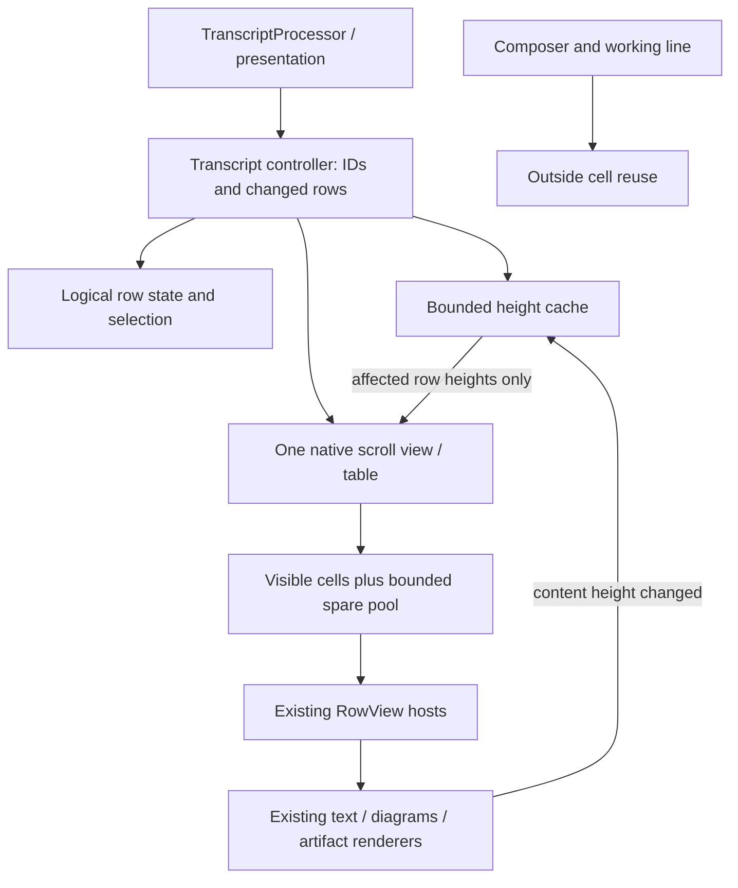

# Reused-cell transcript plan

**Status: proposal, planning only.** No production renderer, behavior or default changes are authorized here.
Revisiting the earlier decision to defer reuse is justified by on-screen hitches, not by a framework preference.
Keep SwiftUI/AppKit, the existing rendering components and the daemon's 250 ms checkpoint cadence.

## Recommendation and decision gate

Evaluate a single-column, view-based `NSTableView` inside one native `NSScrollView`, with reused cells hosting
the existing `RowView`. Keep the composer and working line outside the cell lifecycle. Use explicit, cached
row heights and a changed-row update path, not automatic self-sizing or a whole-table snapshot per chunk.

This is the lowest-risk first candidate, **not a demonstrated fix**. A SwiftUI host per visible row can still
be expensive. Before production integration, compare it with the current renderer using the same real row
views, release fixture, host window and measurement. Also distinguish fixture hosting overhead from normal
app hosting: the current benchmark constructs a standalone `NSHostingView`, whereas the app uses a SwiftUI
`Window`. Removing benchmark-only constraint work must not be mistaken for a transcript improvement.

Prefer `NSCollectionView` only if the table cannot satisfy measured height, responder or accessibility
requirements. Consider native AppKit implementations of individual hot row types only if the reused-host
prototype still spends its frame budget inside those rows. Do not start a wholesale native-row rewrite.

## Current structure and evidence

- `TranscriptProcessor` reduces events off the main actor, caches committed history and builds the live suffix.
  `TranscriptPresentation` exposes separate history/live rows and a history revision. Preserve this work.
- `SessionFeed.rows` publishes to `TranscriptRowsSection`, rather than invalidating the whole composer on every
  chunk. `TranscriptRowsModel` initially exposes 40 historical rows; explicit history requests grow that window.
- `ChatView` uses `ScrollViewReader` and a SwiftUI `ScrollView`. Its measured `VStack` contains an equatable
  history subtree and live rows. The history deliberately stopped using lazy estimated geometry because
  asynchronous Markdown and artifact heights caused jumps. Reuse must solve that problem, not reintroduce it.
- `RowView` supplies text, work groups, tools, events, questions, errors and artifacts. Markdown preparation is
  incremental and off-main; native text uses tail edits. Expansion choices already have external owners.
- `TranscriptScrollObserver` pins the bottom and compensates a reading anchor within native layout, while
  `TranscriptKeyboardModifier` uses row IDs and `ScrollViewProxy`. Both currently depend on the SwiftUI scroller.
- `MessageTextSelection` owns selection **per Markdown message**, spanning its text/code/table regions. It is
  not currently a transcript-wide selection model for unrelated messages. This distinction matters below.
- Artifact revision/size memory is outside individual renderers. Native visual reader state/tree memory also
  survives view recreation; live renderer lifetimes and first responders do not automatically survive reuse.

PR [#898](https://github.com/babariviere/pilot/pull/898) removes probe-induced TextKit invalidation and a
four-slot cache that thrashed across six sizing widths. Most misses were unchanged historical bubbles, not
the streaming text itself. [The full evidence](streaming-layout.md) includes both benchmark batches and
alternating pairs that excluded competing Swift builds:

| 4 updates/s, 100-character chunks, paired medians | Before sizing fix | After sizing fix |
| --- | ---: | ---: |
| Text measurements / ten-second run | 46,414 | 525 |
| Main CPU, percent of one core | 54.8% | 32.5% |
| Hitch time ratio | 524.3 ms/s | 272.7 ms/s |

The after result is the reuse baseline, not an achievement of the under-10 ms/s target. In a separate
nine-second interior Time Profiler sample, main-thread running samples totaled 3,233 ms; inclusive stacks
included 1,112 ms in `NSHostingView.layout`, 528 ms in hosting size-constraint invalidation, 52 ms in text
measurement and 24 ms in fade preparation. These stacks overlap and cannot be summed. They identify hosting/
layout as the next investigation, but do not prove that all of it disappears with reuse.

Paired rich scrolling was mixed: median hitch ratio 258.2 → 252.6 ms/s and main CPU 48.0% → 48.9% across the
sizing fix. Do not claim a scrolling improvement or ignore the possible small cost of a second text layout.

## Options

| Option | Advantage | Main cost/risk | Position |
| --- | --- | --- | --- |
| `NSTableView`, reused cells with existing SwiftUI rows | Native one-column reuse, mature scroll/AX behavior; smallest rendering migration | Row hosts can still remeasure; dynamic heights, responder retention and SwiftUI environments need explicit ownership | First prototype |
| `NSCollectionView`, reused items with existing rows | More control over layout attributes, invalidation and unusual cell retention | A one-column variable-height layout needs its own height/index bookkeeping; no intrinsic speed win over a table | Contingency, not parallel implementation |
| Reused native AppKit rows | Direct `NSTextView` updates and predictable sizing; avoids SwiftUI layout for migrated types | Rebuilds work rows, actions, menus, selection, diagrams/visual composition and AX; greatest parity risk | Selective second step if measured necessary |
| Keep SwiftUI stack, isolate/cache more subtrees | Smallest behavior change; useful control experiment | Does not bound retained row hosts as revealed history grows; layout cache hits still have traversal cost | Baseline/control, not dismissed without comparison |

A fully native transcript would still host existing interactive artifacts and native visual components where
appropriate. Choosing native text rows is not permission to rasterize all content or replace it with web pages.

## Proposed boundaries

### Identity, publication and reuse

- Use one cell per logical `ChatRow` initially, not per Markdown paragraph. Keep work groups and their nested
  tools together. This preserves existing message/selection boundaries and avoids an early block-level rewrite.
- Identify a binding by the full conversation resource/host identity, session generation and row ID, with a
  content/width generation for asynchronous results. Never use an index as identity or infer identity from text.
- Maintain ID-to-index lookup when membership changes. A streamed chunk normally changes only live-tail
  presentation. Update those visible cell models directly; do not rebuild/apply a full diffable snapshot,
  `reloadData`, hash every history string, or traverse the loaded history on each chunk.
- Insert/prepend/delete/reorder only when row membership actually changes. Work grouping and tool-result
  updates can change existing rows, so the adapter cannot assume every history change is append-only.
- Streaming rows currently use `streaming…` identities and committed rows use entry identities. Transfer the
  render-state binding only with a proven message/entry transition. Otherwise replace just that tail row,
  preserve scroll geometry and do not replay its initial fade. Do not invent a content-equality identity.
- A reused cell binds a small row-scoped model, not the whole feed. Supply the same fonts, appearance,
  endpoint/host context, action handlers and expansion owners as today. Do not create a new app model per cell.
- On rebinding, clear old tracking/hover state, selection visuals, fade layers and closures. Cancel obsolete
  tasks and fence every result by binding generation, including artifact size/failure callbacks. An old remote
  artifact must never update a cell now displaying a different conversation or host.
- Keep logical expansion, prepared content, reader state and selection outside the reusable view. Do not
  retain one live hosting view per loaded row. Start with at most one viewport of prefetch and a small bounded
  spare pool (proposed maximum eight lightweight spare hosts); tune it from measurements. Heavy offscreen
  renderers are not spare cells. Respect existing application-wide visual-engine/cache bounds.

### Streaming and height transactions

1. Accept the latest presentation at the existing coalesced publication cadence. Continue off-main incremental
   preparation; keep each unchanged prepared block and native text view. Tail-edit the existing storage in the
   visible streaming row. No new display-rate SwiftUI timer or shorter durable checkpoint interval.
2. Measure a changed visible row once at its actual reading-column width, plus a necessary follow-up if its
   asynchronously prepared content genuinely changes. Cache by conversation, row content revision, width,
   font metrics and expansion/content-size generation. A color-only frame never invalidates height.
3. Give each host an explicit frame and suppress unnecessary hosting min/ideal/max constraint probes. Evaluate
   `sizingOptions`/explicit `sizeThatFits` in the prototype, rather than assuming AppKit automatic row heights
   will be cheap. The outer representable reports its **viewport**, never its document's fitting height.
4. Coalesce affected row IDs in a native layout transaction and notify only those row heights. Disable implicit
   row insert/resize animations. Re-pin or restore the reading anchor before drawing the changed geometry.
   Avoid recursively measuring from height callbacks, and ignore unchanged/subpixel-equivalent sizes.
5. If the live row is offscreen while reading history, retain the latest data and remembered/estimated height,
   not a live host updated four times/s. Realize and settle its actual height when needed. Explicit End/send
   must still land at the true measured bottom, not an estimated tail location.

Resize/font changes invalidate height keys but must not synchronously lay out the entire loaded transcript.
Recompute visible rows first and bounded nearby rows next, using estimates only away from the viewport.
Remembered artifact geometry is not a license to reuse text heights measured at a different width.
Bound measured-height entries by count and bytes (prototype budget: 4,096 entries or 2 MiB), retaining the
visible/anchor entries and falling back to estimates after eviction. Do not duplicate full message strings
in height keys or retain an old cache generation for every window width/font size.

## Preservation contract and unresolved gates

| Area | Required behavior and verification |
| --- | --- |
| Motion (D2) | Existing paced word veils, shimmer and spinners remain opacity/color-only Core Animation in fixed geometry. No animated row height, insertion expansion or per-cell frame timer. Honor Reduce Motion and hidden/occluded windows. Reuse must remove the previous binding's layers without replaying restored text. |
| Column, diagrams, images (D3/D7) | Keep the 760 pt reading column, narrowing with the window, with no web-content zoom. Diagrams/images have natural size, shrink only and enlarge only in the viewer. Preserve native Mermaid with its existing fidelity fallback. The recorded D3 contract says 480 pt maximum; see sizing discrepancy below. |
| Interactive web artifacts (D6/D8) | Click, hover, type, copy and controls stay live inline; viewer stays available. HTML/React hug remembered measured height up to 720 pt, then scroll internally. Keep `ArtifactScrollRouter` edge handoff, horizontal gestures and Escape-to-composer; the new table scroller must be the enclosing transcript scroller, not a second nested chat scroller. No flattened screenshot replacement. |
| Native visuals | Preserve native controls/charts/canvases/shaders/Mermaid, host-qualified revision/state memory, appearance and visibility-driven motion. Reuse must not reset tabs/sliders, leave orphan engine instances, or deliver a late event to another artifact. Current native visuals grow uncapped without nested scrolling; see sizing discrepancy below. |
| Text selection across rows | Keep native glyph selection, drag extension across message regions, tables/code, original-Markdown Select All/copy and native Copy Link. Reuse cannot truncate a logical selection when a contributing view leaves the viewport. The table must not steal drag/Command-C for row selection. See selection model below. |
| Reading position | Reuse the `TranscriptScrollFollow` policy: gesture/keyboard/expansion pauses follow, sending explicitly resumes, and near-bottom rounding is tolerated. While following, pin after chunk or artifact growth; while reading, preserve row ID plus intra-row pixel offset (and the appropriate edge for a straddling row). Preserve this through prepend, expansion, resize, snapshot replacement and estimated-height correction. Never steal an active gesture to chase output. |
| Keyboard and actions | Keep arrow/Home/End highlight by ID, Return disclosure, message copy, Escape to composer, region navigation and earlier-history loading. Replace `ScrollViewProxy` with controller scroll-to-ID callbacks, not index-based focus. Keep edit/retry/restore confirmations and context menus unchanged. Do not intercept text/IME, artifact input or terminal keys; no new blue focus ring. |
| Accessibility | Preserve reading order, text/link semantics, work disclosures and named actions. Expose appropriate native list/row groups without duplicate hosting wrappers. VoiceOver must reach and realize offscreen logical rows without realizing all history. Do not announce the whole transcript on every chunk. Test actual AX navigation and focus, not only a label snapshot. |
| Appearance | Use Theme and the existing font environment in every host. Native visuals follow light/dark; web artifacts retain their existing light document surface. Rebinding must not carry another row's appearance or metrics. No layout redesign. |

**Sizing discrepancy to resolve before rollout.** `ArtifactViewerLayout.inlineImageMaxHeight` currently equals
720, while D3 specifies 480. Native visuals explicitly grow uncapped in `docs/native-visuals.md` and
`VisualArtifactContent`, unlike D8's general 720 pt artifact ceiling. The container migration must call these
out for an explicit policy decision and delegate sizing to the existing shared layout helpers meanwhile.
It must not silently crop tall visuals, introduce a nested visual scroller, or retune image heights as an
incidental consequence of reuse. Contract reconciliation is separate from proving the container's performance.

**Selection is model state, not a pinned view for every selected row.** Keep source positions keyed by logical
row/message and UTF-16 region offsets. Reapply highlights only to mounted regions; copy must read selected
source ranges even when intermediate rows are offscreen. This extends the current per-message ownership if
selection across separate chat rows/messages is required, rather than pretending it already exists. Define
paragraph separators, Markdown-vs-rendered-text copy, table tabs, Select All scope and append/edit clamping in
tests before enabling it. Do not concatenate every loaded message on each pointer move or chunk. A long drag
may autoscroll/realize nearby rows, but must not pin the entire selected history in memory.

**Focused editors are a prototype gate.** A focused artifact/editor, its field editor/undo state, and an active
selection drag must not be rebound to another row. Demonstrate the table's offscreen/responder behavior with
an interactive WKWebView and native controls, not only `Text`. A bounded focused renderer lease may be needed,
separate from cell reuse. If AppKit cannot retain the responder safely, choose a different container/retention
strategy before rollout, rather than silently blurring the editor or keeping every artifact live forever.
Persisted visual JSON does not by itself preserve arbitrary web DOM/input state across teardown; define and
test the same supported remount behavior as today, with no accidental new reloads during a focused edit.

## Small migration PRs, each requiring separate implementation approval

1. **Measurement and standalone prototype.** Compare current stack, table with existing row hosts, and only
   if necessary a collection layout. Same data, release configuration, window, widths and renderer features;
   no production default change. Add counts for mounted hosts, cell creation/rebinds, height cache misses,
   row measurements, whole-window layout and stale callbacks. Prove the outer sizing boundary, variable-height
   convergence and focused-artifact behavior. A plain native-text variant is an upper-bound experiment, not
   an apples-to-apples win over rich rows. This planning PR contains no prototype or new performance result.
2. **Identity/state adapter.** Add deterministic client-side tests for changed live rows, commits/grouping,
   prepend, snapshot/recovery, remote resource identity and stale asynchronous callbacks. Carry external
   expansion/selection/height state. No protocol or history-storage change is initially needed; do not add
   history-sized main-thread copying just to drive a native data source.
3. **Opt-in table with plain/work rows.** Keep the existing renderer as default. Integrate the one native
   scroller, bounded cell pool, explicit width/height updates and follow/reading-anchor controller. Preserve
   the initial 40-row history window and explicit paging. Benchmark after this PR; stop if host reuse does
   not substantially reduce main-thread work or if unchanged history is still measured per chunk.
4. **Interaction parity.** Complete selection across reuse boundaries, keyboard-to-ID routing, existing
   message actions, first responder/IME and VoiceOver. Add native interaction tests and at least one real
   window journey. Do not enable a faster read-only transcript in production as a shortcut around parity.
5. **Rich rows and lifecycle parity.** Exercise dynamic tools, diagrams, images, web artifacts and native
   visuals, including tall content, loading/failure/retry, late resize, host switches, expanded viewer and
   focused editing. Port anchor/lifecycle fixtures to the native container. Audit renderer leases, listeners,
   timers, tasks and process counts after repeated scroll-away/return and closing a chat.
6. **Measured choice and rollout.** Run the full release A/B matrix and interaction/AX gates. If row-local
   SwiftUI still dominates, propose a small native text/work-row follow-up with its own parity budget; do not
   rewrite all row types. Enable only after the acceptance targets and sizing decisions are resolved, with
   an explicit rollback path. Remove the old stack only in a later, separately reviewed cleanup.

One giant text reply or uncapped visual can occupy a single very tall cell. Cell reuse alone does not bound
that row's internal layout. Splitting such content into reusable blocks is a separate measured option, with
selection/source mapping and artifact interaction costs, not part of the first container migration.

## Numbers, verification and stop conditions

The numbers below are **provisional budgets/hypotheses, not measured predictions**. No prototype was run for
this planning document: a toy list would not answer whether the real row hosts, responder behavior and rich
content meet the constraints. Approve the measurement step before committing to a production container.

| Stage / workload | Expected budget or go/no-go test |
| --- | --- |
| First real reused-host prototype, 4/s | Seek at least 50% lower main CPU than the matched post-#898 baseline (about 32.5% → at most 16%) and a clear hitch reduction (about 273 → below 140 ms/s). This only justifies further evaluation, not rollout. If not achieved, inspect the remaining stacks before adding more infrastructure. |
| Final 4/s, 100-character chunks | Under **10 ms/s in every one of at least three runs**, with median under 5 ms/s as the stretch goal; provisional main CPU at most 10% of one core. No row jumps or repeated layout of unchanged history. A table is not automatically expected to meet this. |
| 10/s and 50/100/s stress | Improve matched hitch/CPU and delivered cadence; do not hide work by dropping final text, making chunks larger or increasing durable writes. Provisional stress goals are under 50 ms/s at 50/s and under 100 ms/s at 100/s, to be revised from prototype evidence. Report actual elapsed time and lateness, because overloaded workloads can exceed nominal duration. |
| Rich scrolling / resizing | Meet the 120 Hz 8.33 ms frame budget where possible: p95 native scroll step below 8 ms, hitch ratio below 10 ms/s as the final goal, and no regression beyond paired-run noise. Include resize/font-change storms, pinned bottom and reading anchors, not only fixed text. |
| Idle / memory | After completion, at most 1% CPU over the existing five-second idle sample. Do not increase the matched four-updates/s physical footprint (roughly 242 MiB in the current fixture); aim for a reduction as revealed history grows. Measure app plus WebKit/XPC helpers. Separate canonical transcript data growth from renderer growth: mounted/spare view and live-renderer counts must plateau as revealed rows grow from 1,000 to 10,000. |

Run `apps/macos/scripts/bench-streaming.sh` before/after at the same release heads, then alternating paired
runs. Hold the shared Swift verification slot across a comparison, use AC power and an unlocked on-screen
120 Hz display, and record competing app activity, versions, temperature/thermal limitations and widths.
Keep profiler/signpost captures separate from headline numbers. Test 760 pt and narrow columns, long unbroken
text, a very long single reply, and both 1,000/10,000 **loaded and actually revealed** rows; the default
40-row window otherwise conceals reuse scaling. Do not shrink the fixture or change the cadence to pass.

Use the existing synthetic performance/opening/artifact fixtures, not live accounts. Preserve/extend
`TranscriptHistoryIsolationTests`, `TranscriptMessageLoadingTests`, `TranscriptScrollObserverTests`,
`TranscriptScrollStabilityTests`, `TranscriptScrollFollowTests`, `MessageTextSelectionTests`,
`ArtifactLifecycleTests`, `InlineArtifactLayoutTests` and keyboard journeys. Add explicit tests for recycling
a selected row, range copy across offscreen rows, focused artifact scroll-away/return, an artifact resize
after reuse, session/host switch during preparation and a streaming-to-committed identity change. Verify
light/dark, Reduce Motion and VoiceOver by native interactions. Use remote CI for full native suites; approved
local release prototypes/benchmarks use the existing wrappers and shared slots.

Stop rollout for selection/focus loss, stale content crossing bindings, unbounded hosts/engines, anchor jumps,
artifact gesture regressions, or a persistent performance regression. If only the synthetic hosting path
improves, fix that measurement discrepancy and repeat before attributing a win to cell reuse. Publish actual
before/after tables for every performance PR and retain the existing renderer until these gates pass.
